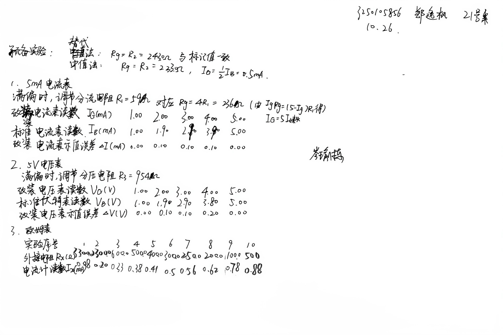
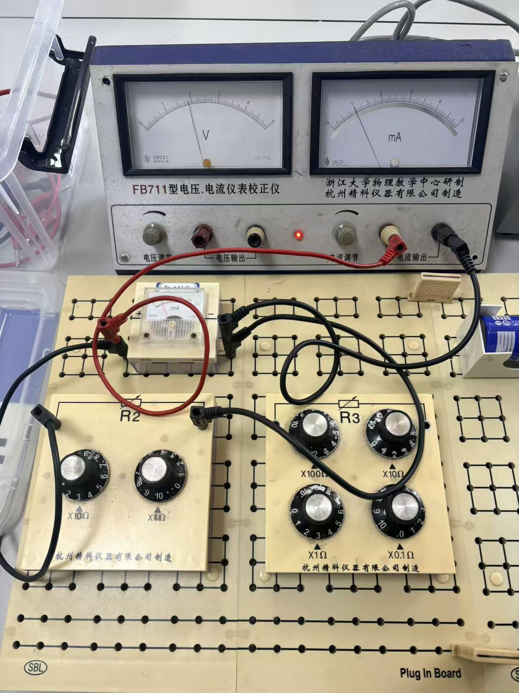
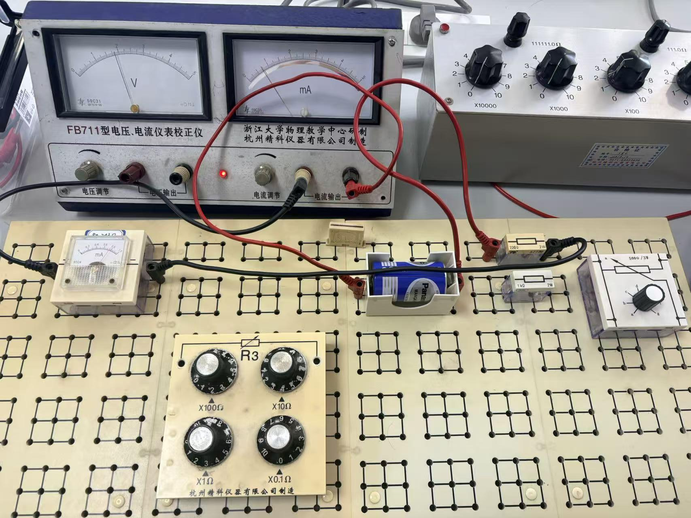
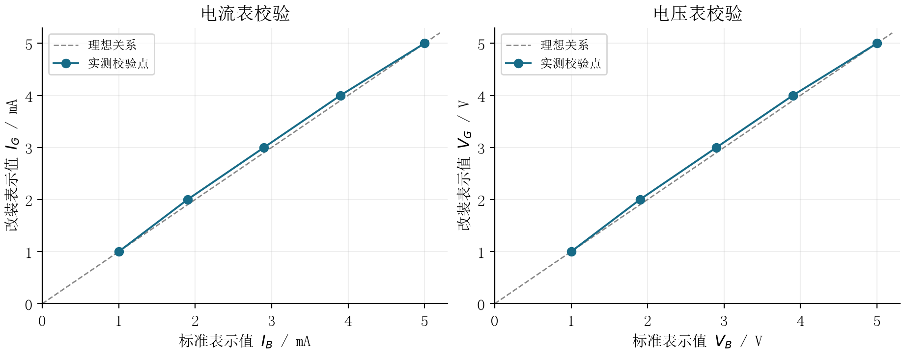
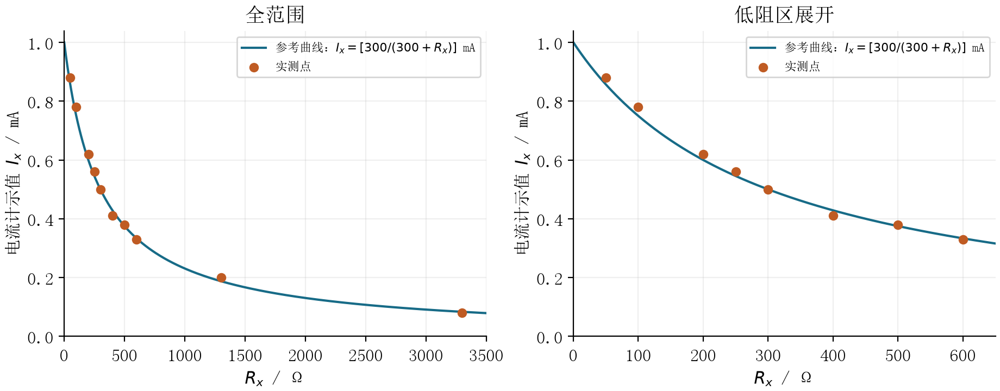
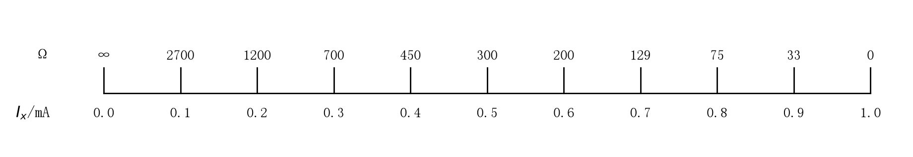

# 万用表的设计实验报告

- 课程：物理学实验 I
- 班级：软件工程 2502 班
- 姓名：郑逸枫
- 学号：3250105856
- 指导教师：岑瑜栋
- 实验时间：2026 年 10 月 26 日上午 10:00
- 实验地点：东四 131，21 号桌

# 一、实验目的与原理

## 1. 实验目的

测量电流计内阻，利用分流、分压电阻将其改装成单量程 5 mA 电流表和 5 V 电压表，并用标准表校验示值、评定等级；组装欧姆表，观察电流与待测电阻的关系，理解欧姆刻度的非均匀性。

## 2. 电流计内阻与电流表改装

电流计满偏电流为 $I_g=1\,\mathrm{mA}$，内阻为 $R_g$。替代法保持电源及其他电阻不变，用电阻箱替换电流计，调至回路电流恢复原值，电阻箱读数即为表头内阻。中值法在电流计两端并联电阻，并保持总电流不变，调至电流计半偏，此时并联电阻等于表头内阻。

本次课堂采用单量程电路，只需在表头两端并联一个分流电阻 $R_1$。由两支路电压相等，

$$
I_gR_g=(I_m-I_g)R_1,\qquad R_1=\frac{I_gR_g}{I_m-I_g}=\frac{R_g}{4},\quad I_m=5\,\mathrm{mA}.
$$

改装表示值 $I_G$ 为原电流计示值的五倍。校验时改装表与标准安培表串联，比较同一回路电流下的两表示值。

## 3. 电压表改装

保留改装电流表的分流支路，将其作为等效表头。其满偏电流 $I'_g=5\,\mathrm{mA}$，等效内阻为

$$
R'_g=\frac{R_gR_1}{R_g+R_1}.
$$

串联分压电阻 $R_3$ 后，满偏电压满足

$$
(R_3+R'_g)I'_g=5\,\mathrm V,\qquad R_3=1000\,\Omega-R'_g.
$$

校验时将改装表与标准伏特表并联，比较同一电压下的两表示值。

## 4. 欧姆表原理

本次欧姆表保留电流表的并联分流支路，使用一节 1.5 V 电池和 220 Ω 保护电阻。短接调零时，原电流计指针满偏为 1.00 mA，改装电流表的满偏总电流为 5 mA。欧姆表利用内置电源使电流通过待测电阻。短接表笔调零后，记表头满偏示值为 $I_0$、从测量端口看入的等效内阻为 $R_0$，在电源和接线保持不变时有

$$
\frac{I_x}{I_0}=\frac{R_0}{R_0+R_x},\qquad R_x=R_0\left(\frac{I_0}{I_x}-1\right).
$$

短接时 $R_x=0$，指针满偏；开路时 $R_x\to\infty$，电流趋于零；半偏时 $R_x=R_0$。电阻与电流不是线性关系，电阻刻度从大到小的方向与电流刻度相反，高阻端密、低阻端疏。

# 二、实验操作与原始数据

## 1. 实验装置与原始记录

实验使用 1 mA 电流计、FB711 型电压电流仪表校正仪、电阻箱、可调电阻、面包板和干电池。先测表头内阻，再完成 5 mA、5 V 单量程改装和校验，最后记录欧姆表的电阻—电流对应关系。

## 2. 电流计内阻

| 方法 | 内阻读数/Ω | 原始记录说明 |
|---|---:|---|
| 替代法 | 243 | 表头标记值 242 Ω |
| 中值法 | 233.5 | 电流计半偏 0.5 mA |

## 3. 电流表校验

满偏校准后分流电阻 $R_1=59\,\Omega$。

| 序号 | 改装表 $I_G$/mA | 标准表 $I_B$/mA |
|---|---:|---:|
| 1 | 1.00 | 1.00 |
| 2 | 2.00 | 1.90 |
| 3 | 3.00 | 2.90 |
| 4 | 4.00 | 3.90 |
| 5 | 5.00 | 5.00 |

## 4. 电压表校验

| 序号 | 改装表 $V_G$/V | 标准表 $V_B$/V |
|---|---:|---:|
| 1 | 1.00 | 1.00 |
| 2 | 2.00 | 1.90 |
| 3 | 3.00 | 2.90 |
| 4 | 4.00 | 3.90 |
| 5 | 5.00 | 5.00 |

满偏校准后串联分压电阻 $R_3=954\,\Omega$。

## 5. 欧姆表读数

电源电压为 1.5 V，保留并联分流电阻；短接时电流计示值为 1.00 mA。表中 $I_x$ 为电流计示值。

| 序号 | $R_x$/Ω | $I_x$/mA | 序号 | $R_x$/Ω | $I_x$/mA |
|---|---:|---:|---|---:|---:|
| 1 | 3300.0 | 0.08 | 6 | 300.0 | 0.50 |
| 2 | 1300.0 | 0.20 | 7 | 250.0 | 0.56 |
| 3 | 600.0 | 0.33 | 8 | 200.0 | 0.62 |
| 4 | 500.0 | 0.38 | 9 | 100.0 | 0.78 |
| 5 | 400.0 | 0.41 | 10 | 50.0 | 0.88 |

# 三、数据处理与结果分析

## 1. 内阻结果比较

替代法测得内阻为 243 Ω，中值法测得内阻为 233.5 Ω，两者相差 9.5 Ω。两种方法的差异可能与总电流保持程度、读数及接触电阻有关，我主观认为的原因是：标准电流表精度有限，当电阻改变量较小的情况下，标准电流表示数均不变，导致电阻测量误差较大。

以替代法测得的 $R_g=243\,\Omega$ 设计电路，初始理论分流电阻为 $R_1=243/4=60.75\,\Omega$，理想等效内阻为 $R'_g=243/5=48.6\,\Omega$，对应理论分压电阻为 $R_3=1000-48.6=951.4\,\Omega$。这些是电路设计阶段的设计值。最终使用满偏校准后得到的 59 Ω、954 Ω，二者分别比初始设计值低 1.75 Ω、高 2.6 Ω，相对误差的绝对值分别为 $\approx2.88\%$ 和 $\approx0.27\%$，可以接受。

## 2. 校验曲线与仪表等级

按课堂要求，示值误差取改装表读数减去标准表读数，即 $\Delta I=I_G-I_B$、$\Delta V=V_G-V_B$。以各校验点的最大绝对示值误差计算引用误差，再在课件列出的等级 0.1、0.2、0.5、1.0、1.5、2.5、5.0 中向上选取满足要求的等级。

电流表五点示值误差为 0.00、0.10、0.10、0.10、0.00 mA，最大绝对示值误差为 0.10 mA，故

$$
k_I=\frac{0.10}{5.00}\times100=2.0.
$$

最大引用误差为 2.0%，介于 1.5 级与 2.5 级之间，向上取 2.5 级。

电压表在 2.00 V、3.00 V、4.00 V 三个校验点的示值误差均为 $0.10\,\mathrm V$，最大绝对示值误差为 $0.10\,\mathrm V$，故

$$
k_U=\frac{0.10}{5.00}\times100=2.0.
$$

按本次五个校验点，电压表最大引用误差为 2.0%，评为 2.5 级。满偏点误差为零，只说明该点校准一致，不能据此认定整个量程无误差。

图中横轴为标准表示值，纵轴为改装表示值。连线仅用于显示相邻校验点的趋势，虚线为理想关系。中间校验点整体位于理想线上方，说明这些点的改装表示值偏大。

## 3. 欧姆刻度分布

组装好欧姆表后，短接电路，调节调零电阻使得电流计满偏为 $I_0=1.00\,\mathrm{mA}$，实测 $R_x=300.0\,\Omega$ 时电流为 $0.50\,\mathrm{mA}$，故中值电阻为

$$
R_0=300.0\,\Omega.
$$

本实验记录的 $I_x$ 均为电流计支路的示值。保留分流支路时，电流计满偏示值为 1.00 mA，对应回路总电流为 5.00 mA。由标称电源电压估算，回路内阻为 $1.5\,\mathrm V/(5.00\,\mathrm{mA})=300\,\Omega$，与电流计半偏时测得的中值电阻一致。下式及图中的 $I_x$ 均表示电流计支路电流：

$$
I_x=\frac{300.0}{300.0+R_x}\times1.00\,\mathrm{mA}.
$$

图中实测点随电阻增大而下降，整体接近参考曲线，实验测量结果较为满意。

图中按电流等间距标出对应的理论电阻。接近零电流时，微小的电流变化对应很大的电阻变化，因此高阻端密集；接近满偏时刻度较疏。

## 4. 误差分析

1. **内阻测量：** 替代法和中值法的结果相差 9.5 Ω。替代法中，因为标准电流表的精度有限，电阻小幅变化时标准电流表示数可能仍不变，使“恢复原电流”的判断存在范围；中值法既要保持总电流不变，又要判断表头是否半偏，两次调节和读数都会引入偏差，所以也会存在一定误差。

2. **电流表与电压表校验：** 两表满偏点误差均为零，但中间三个校验点分别偏大 0.10 mA 和 0.10 V，说明仅调准满偏点不能消除全量程偏差。误差的其他原因还可能有：表头刻度非线性、读数视差，分流、分压电阻的实际阻值及接触电阻也会影响校准。

3. **欧姆表测量：** 高阻端的电流较小，如 3300.0 Ω 时表头仅为 0.08 mA，指针位置的微小判断差异就会导致电阻读数出现较大偏差。注意在测量之前，需要短接电路并调节调零电阻使得小表头满偏，否则会导致较大误差。总而言之，应在测量前短接调零，保证表笔接触可靠，并优先在中值电阻附近读数。

# 四、实验心得与思考题

## 1. 实验心得

通过本次实验，我学会了用替代法和中值法测量电流计内阻，并利用分流、分压电阻将表头改装为电流表和电压表。在电路设计时，需要分清原表头电流、改装表总电流、标准表电流，避免参数混用。从校验结果中，我意识到即使满偏点调准后，中间刻度仍可能存在偏差，因此应检查多个校验点，再评定仪表等级。组装欧姆表时，应先短接调零，并结合表头电流半偏点理解电阻刻度的分布。此外，记录电阻箱读数时要写清小数位。读所有表时都要正视刻度，减小读数误差。

## 2. 思考题

1. **为什么不能用万用表欧姆挡测量电源内阻？** 欧姆挡依靠内置电源产生测量电流。若接入另一个电源，其电动势也会影响电流，使读数失去意义，还可能损坏表头。因此，电源内阻应通过负载变化时的端电压和电流来测量。

2. **数字万用表与指针式万用表有什么差异？** 指针式万用表通过指针偏转显示数值，便于观察变化趋势，但需要估读，存在视差，欧姆挡刻度也不均匀。数字万用表将测量信号转换为数字直接显示，读数方便，电压挡通常具有较高输入电阻，对被测电路的影响较小；不过，显示位数多并不代表准确度一定高，仍需查看具体指标。

3. **欧姆表中干电池内阻变化有什么影响？** 电池内阻增大时，测量电流减小，指针偏转变小，按原刻度读出的电阻会偏大。若电动势不变且调节范围足够，可通过重新调零补偿；若电池老化同时使电动势下降，即使能调零，刻度关系也可能改变，应及时更换电池。
