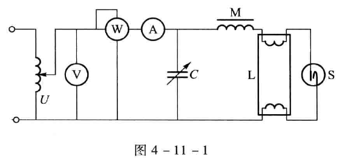
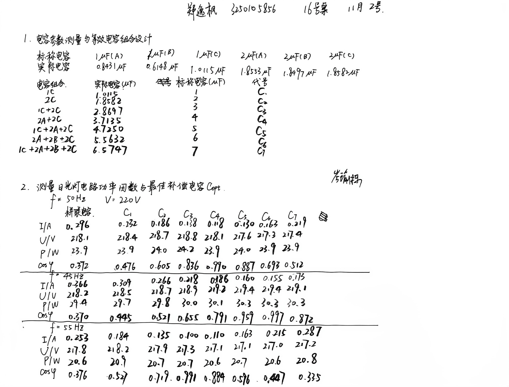
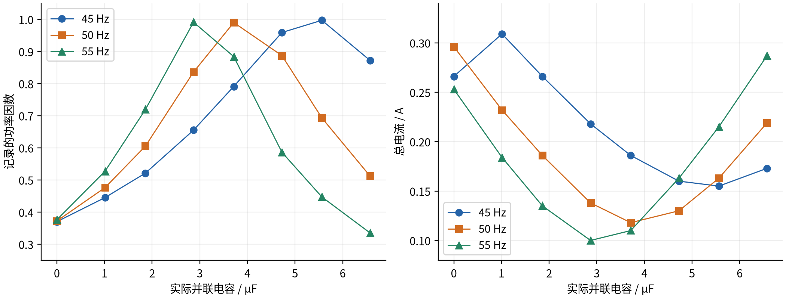

# 交流电路功率因数实验报告

课程：物理学实验 I；姓名：郑逸枫；学号：3250105856；班级：软件工程2502班；指导教师：岑瑜栋；地点：东四133（16号桌）；日期：2026年11月2日星期一上午10:00。

# 一、预习报告

## 1. 实验综述

通过预习，我了解到日光灯电路是典型的感性负载。本实验先组装日光灯电路，再测量并联不同电容时的电压、电流和功率，研究提高功率因数（power factor）的方法。

日光灯由灯管、镇流器和启辉器组成。启动时，启辉器先接通使灯丝预热，随后断开，镇流器产生自感高压，使灯管内气体放电，激发荧光粉发光。正常工作后，启辉器保持断开，镇流器起限流作用。

图中 $M$、$L$、$S$ 分别为镇流器、灯管和启辉器，$C$ 为补偿电容。按教材的正弦交流模型，电路有功功率为

$$
P=UI\cos\varphi,\qquad \cos\varphi=\frac{P}{UI},
$$

其中 $U$、$I$ 为电压和电流的有效值，$\varphi$ 为相位差。感性负载的电流滞后于电压；并联适当电容后，电容电流补偿滞后分量，使总电流减小、功率因数提高，从而降低线路损耗。不过，电容过大时会出现过补偿，总电流重新增大，功率因数反而下降。

由于标称数据可能不准确，需要先打开 LCR 电表，切换至电容档，重新测量各电容的实际电容值。注意必须在实验开始前测量电容，避免实验中再测量因电容放电损伤 LCR 电表。接着使用变频交流电源，将输出电压调至 $220\,\mathrm{V}$，分别在 $45,50,55\,\mathrm{Hz}$ 下测量。随后测量未接电容时的 $U$、$I$、$P$，再保持供电电压和频率一致，按教材依次接入 $1\sim7\,\mu\mathrm{F}$ 的电容并记录读数。随后计算各组功率因数，绘制 $\cos\varphi-C$ 曲线，找出已测档位中功率因数最大时的电容值，并比较补偿前后电流和功率的变化。

## 2. 实验目的

1. 了解日光灯的工作原理，掌握电路的组装方法。
2. 学习交流电压表、电流表和功率表的使用，测量电路功率因数。
3. 理解并联电容提高功率因数的原理，观察过补偿现象。

## 3. 实验重点与难点

1. 正确连接功率表的电流、电压线圈及同名端，分别核对量程，避免过载。
2. 比较不同电容时保持电压和频率一致，待灯管和示数稳定后读数；注意交流电流应按相量相加，不能直接相加有效值。
3. 接线须经教师检查后才能通电。开启时从左到右依次打开开关，关闭时从右到左依次关闭开关。严禁带电接线、改线或更换电容，操作前须断电并按要求使电容安全放电。

# 二、实验操作与原始数据

## 1. 实验操作与原始记录

用于标称电容可能不准或已经被击穿，正式实验前需要用 LCR 电表测量电容，再组成七个补偿档位。电源设为220 V，按50、45、55 Hz的顺序测量，每种频率记录八组数据。

同一频率下，我依次测量未加电容及各补偿档位的电流、电压、功率和功率因数。以下为原始记录及转录表。

## 2. 电容参数与组合

1A表示标称1 μF的A号电容，其余类推。各电容的实测值如下。

| 电容编号 | 1A | 1B | 1C | 2A | 2B | 2C |
| --- | --- | --- | --- | --- | --- | --- |
| 实测值/μF | 0.8431 | 0.6148 | 1.0115 | 1.8553 | 1.8497 | 1.8582 |

<!-- pagebreak -->

各档电容均采用并联组合，编号及电容值如下。

| 档位 | 并联组合 | 标称值/μF | 实际值/μF |
| --- | --- | --- | --- |
| $C_1$ | 1C | 1 | 1.0115 |
| $C_2$ | 2C | 2 | 1.8582 |
| $C_3$ | 1C+2C | 3 | 2.8697 |
| $C_4$ | 2A+2C | 4 | 3.7135 |
| $C_5$ | 1C+2A+2C | 5 | 4.7250 |
| $C_6$ | 2A+2B+2C | 6 | 5.5632 |
| $C_7$ | 1C+2A+2B+2C | 7 | 6.5747 |

## 3. 三种频率下的测量数据

表内均为现场测量值，电压为实测值。

**50 Hz：**

| 量 | 未加电容 | $C_1$ | $C_2$ | $C_3$ | $C_4$ | $C_5$ | $C_6$ | $C_7$ |
| --- | --- | --- | --- | --- | --- | --- | --- | --- |
| $I$/A | 0.296 | 0.232 | 0.186 | 0.138 | 0.118 | 0.130 | 0.163 | 0.219 |
| $U$/V | 218.1 | 218.4 | 218.7 | 218.8 | 218.1 | 217.6 | 217.3 | 217.4 |
| $P$/W | 23.9 | 23.9 | 24.0 | 24.2 | 23.9 | 24.0 | 23.9 | 23.9 |
| $\cos\varphi$ | 0.372 | 0.476 | 0.605 | 0.836 | 0.990 | 0.887 | 0.693 | 0.512 |

**45 Hz：**

| 量 | 未加电容 | $C_1$ | $C_2$ | $C_3$ | $C_4$ | $C_5$ | $C_6$ | $C_7$ |
| --- | --- | --- | --- | --- | --- | --- | --- | --- |
| $I$/A | 0.266 | 0.309 | 0.266 | 0.218 | 0.186 | 0.160 | 0.155 | 0.173 |
| $U$/V | 218.2 | 218.5 | 218.7 | 218.9 | 219.2 | 219.4 | 219.4 | 219.1 |
| $P$/W | 29.4 | 29.7 | 29.8 | 30.0 | 30.1 | 30.3 | 30.3 | 30.3 |
| $\cos\varphi$ | 0.370 | 0.445 | 0.521 | 0.655 | 0.791 | 0.959 | 0.997 | 0.872 |

**55 Hz：**

| 量 | 未加电容 | $C_1$ | $C_2$ | $C_3$ | $C_4$ | $C_5$ | $C_6$ | $C_7$ |
| --- | --- | --- | --- | --- | --- | --- | --- | --- |
| $I$/A | 0.253 | 0.184 | 0.135 | 0.100 | 0.110 | 0.163 | 0.215 | 0.287 |
| $U$/V | 217.8 | 218.2 | 217.9 | 217.3 | 217.1 | 217.1 | 217.0 | 217.2 |
| $P$/W | 20.6 | 20.9 | 20.7 | 20.7 | 20.6 | 20.7 | 20.6 | 20.8 |
| $\cos\varphi$ | 0.376 | 0.527 | 0.719 | 0.991 | 0.884 | 0.586 | 0.447 | 0.335 |

# 三、结果与分析

## 1. 功率因数与有功功率

根据电容的并联特性，并联电容满足 $C=\sum C_i$。下图以实际电容为横坐标，绘制三种频率下的功率因数和总电流曲线，连线仅表示趋势。

三组功率因数均随电容增加先升高后降低，说明适当补偿有效，而过补偿会使效果变差。

接着，我用实测的 $P$、$U$、$I$ 核对功率因数。各组峰值处的对比如下。

| 频率/Hz | 档位 | 现场功率因数 | $P/(UI)$ |
| --- | --- | --- | --- |
| 45 | $C_6$ | 0.997 | 0.891 |
| 50 | $C_4$ | 0.990 | 0.929 |
| 55 | $C_3$ | 0.991 | 0.953 |

例如50 Hz、$C_4$处，$23.9/(218.1\times0.118)\approx0.929$。现场测量值与复算值存在差异，但峰值所在档位一致。下文仍按现场测量值比较，差异会在误差分析中讨论。

另外，同一频率下，有功功率变化较小：45 Hz为29.4—30.3 W，50 Hz为23.9—24.2 W，55 Hz为20.6—20.9 W。因此，并联电容主要改善功率因数、减小线路电流，并未明显降低负载的有功功率。

<!-- pagebreak -->

## 2. 最佳电容与有功功率

依据上文的测量，按功率因数最大值选取最佳电容如下。

| 频率/Hz | 最佳档位 | 实际电容/μF | 记录的最大功率因数 | 对应电流/A |
| --- | --- | --- | --- | --- |
| 45 | $C_6$ | 5.5632 | 0.997 | 0.155 |
| 50 | $C_4$ | 3.7135 | 0.990 | 0.118 |
| 55 | $C_3$ | 2.8697 | 0.991 | 0.100 |

频率升高时，最佳档位对应的电容减小。由 $I_C=2\pi fCU$ 可知，同一电容的补偿电流随频率增大而增大。

## 4. 误差分析

1. 标称1 μF的B号电容实测仅为0.6148 μF，说明标称值可能有较大偏差。因此，我在最终数据处理时，采用实测值计算组合电容，避免实验系统误差。
2. 实测电压为217.0—219.4 V。电源波动和灯管未稳定都可能影响读数，带来人为的读数误差。
3. 现场功率因数与 $P/(UI)$ 不完全一致，可能原因有未等到示数稳定就读数、仪表模式有误和仪表准确度较差。
4. 电容档位有限，峰值可能落在两档之间，可在最大值附近加密测量以获得更精确的最佳电容。

各条件仅测一次，且缺少仪器允许误差限，因此本次不评定 A、B 类及合成标准不确定度。

# 四、实验心得与思考题

## 1. 实验心得

通过本次实验，我对并联电容提高功率因数的过程有了更直观的认识。
1. 随着电容增大，功率因数先升高后降低，总电流则在最佳档位附近达到最小值，说明电容补偿并非越大越好。
2. 同时，同一频率下的有功功率变化较小，让我理解了补偿主要是减小无功电流和线路损耗，而不是降低灯管本身消耗的功率。
3. 比较三种频率的数据后，我发现频率越高，最佳档位对应的电容越小，因此选择补偿电容时也要考虑电源频率。
4. 最后，强电实验必须重视操作顺序，接线和更换电容前先断电，确认电容安全放电后再操作。

## 2. 思考题

### 1. 提高功率因数的意义何在？为什么并联电容能提高功率因数？电容是否越大越好？

1. 在电压和有功功率一定时，提高功率因数可减小线路电流，降低导线的 $I^2R$ 损耗和电压降，提高供电设备的利用率。
2. 感性负载电流滞后于电压，电容电流超前于电压。两者的无功分量相互抵消，使总电流与电压的相位差减小。
3. 电容不是越大越好。超过适当补偿值后，电路出现过补偿，总电流增大，功率因数反而下降。

### 2. 随电容增加，总电流为什么先减小后增大？

在正弦交流近似下，将负载电流分为有功分量 $I_P$ 和感性无功分量 $I_Q$，则并联电容后的总电流为

$$
I=\sqrt{I_P^2+(I_Q-2\pi fCU)^2}.
$$

1. 欠补偿时，增加电容使剩余无功电流减小，总电流随之下降。
2. 接近完全补偿时，两种无功电流基本抵消，总电流达到最小值。
3. 继续增加电容，容性无功电流占主导，总电流重新增大。本次50 Hz和55 Hz的测量清楚地体现了这一趋势。

### 3. 为什么采用并联电容，而不采用串联电容？

1. 并联电容补偿无功电流，在电源电压不变时，基本不影响原日光灯支路的工作状态。
2. 串联电容会改变支路阻抗和电压分配，影响灯管工作；接近谐振时还可能产生过电流或过电压。因此，本实验采用并联补偿。
