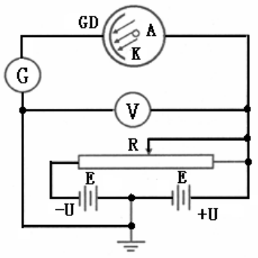
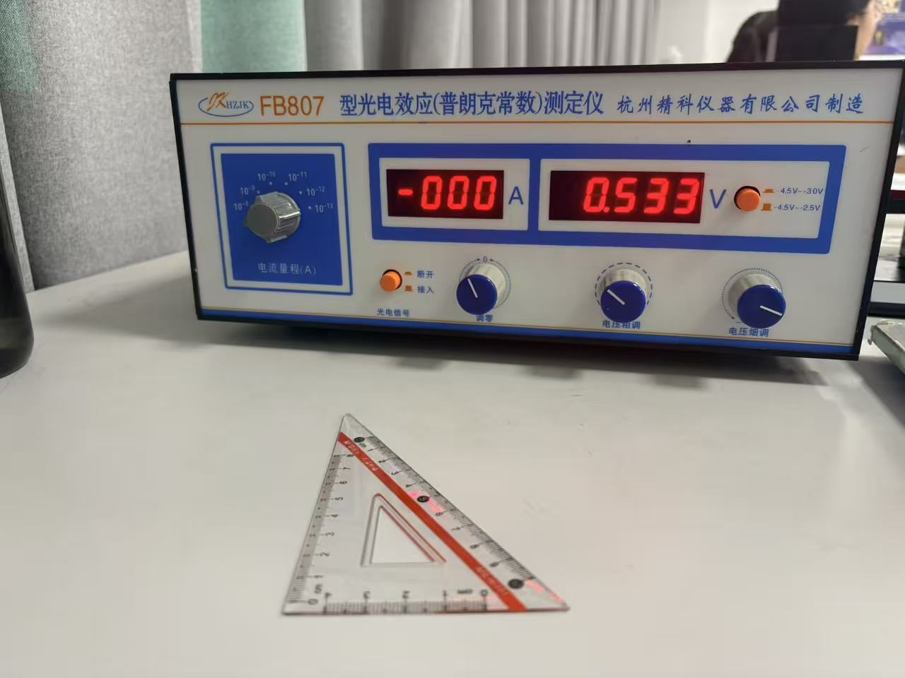
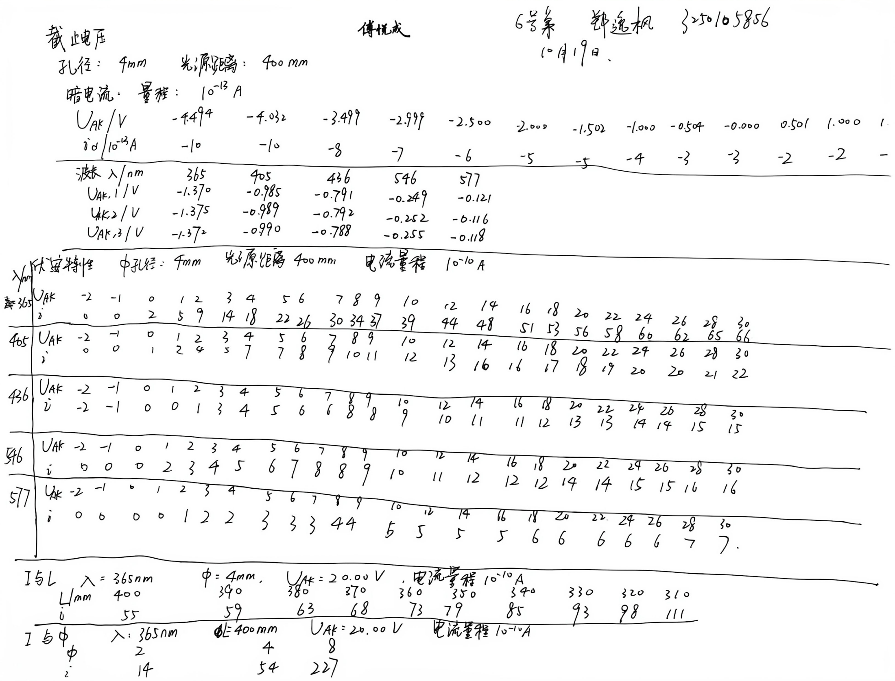
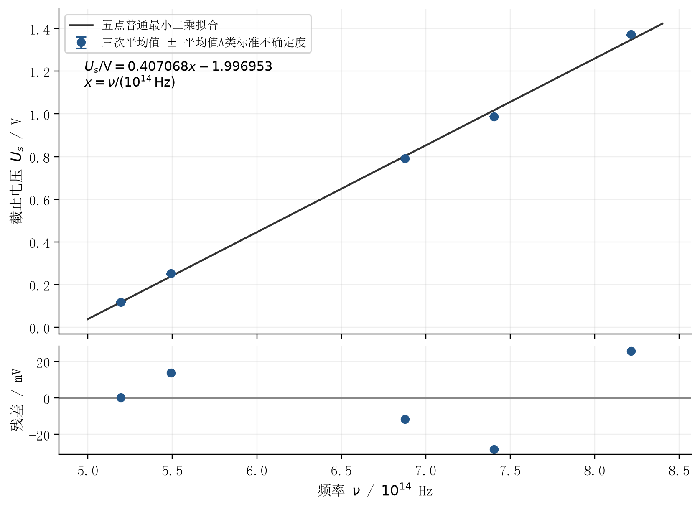
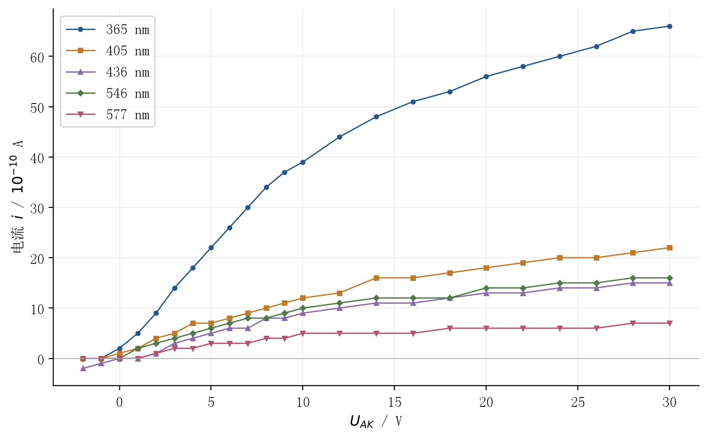
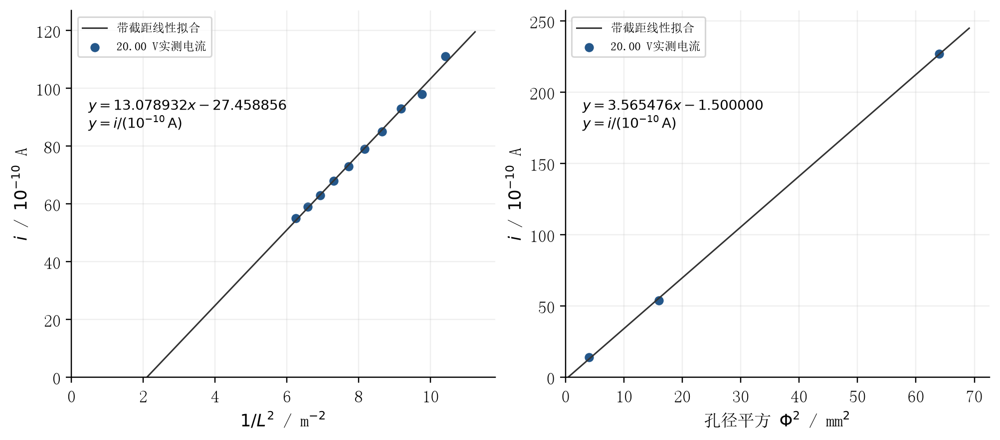

# 光电效应测定普朗克常数实验报告

课程：物理学实验 I；姓名：郑逸枫；学号：3250105856；班级：软件工程2502班；指导教师：傅悦成；实验桌号：6号桌；实验日期：2026年10月19日星期一上午。

# 一、预习报告

## 1. 实验综述

通过预习，我了解到光电效应（photoelectric effect）是物质受到光照后释放电子的现象。光子（photon）的能量为 $h\nu$，电子吸收能量后，一部分用于克服逸出功（work function）$W$，其余成为动能。爱因斯坦光电效应方程为

$$
h\nu=W+\frac{1}{2}mv_{\max}^{2}.
$$

因此，只有频率达到红限频率（threshold frequency）$\nu_0=W/h$ 才可能发生光电子发射；在频率不变时，增强光照主要增加光电子数目，不改变最大初动能。

实验使用 FB807 型光电效应测定仪，由汞灯、滤光片、光阑、光电管及电压和微电流测量装置组成。图中 $K$、$A$ 分别为阴极和阳极，$G$、$V$ 分别测量电流和电压。改变阳极相对阴极的电压 $U_{AK}$，可以测得伏安特性曲线（current–voltage characteristic）。正向电压增大时，电流逐渐达到饱和值；施加反向电压时，光电子受到阻碍，阴极光电流逐渐减小。

将恰好阻止最大初动能电子到达阳极的反向电压大小记为截止电压（stopping potential）$U_a>0$，则

$$
eU_a=\frac{1}{2}mv_{\max}^{2},\qquad U_a=\frac{h}{e}\nu-\frac{W}{e}.
$$

我需要区分仪器显示的负电压 $U_{AK}$ 与用于拟合的正值 $U_a=|U_{AK}|$。对不同单色光分别测量截止电压，用 $\nu=c/\lambda$ 换算频率，再拟合 $U_a=k\nu+b$，可得

$$
h=ek,\qquad W=-eb,\qquad \nu_0=-\frac{b}{k}.
$$

拟合时频率统一用 Hz，电压用 V，所得 $h$ 的单位为 $\mathrm{J\cdot s}$。若横轴用 $10^{14}\,\mathrm{Hz}$ 为单位，则图上斜率须乘 $10^{-14}$ 后才能代入 $h=ek$。截距容易受到接触电势差等因素影响，因此由截距求出的逸出功和红限频率还需结合实际误差讨论。

操作时先检查接线，使汞灯和测试仪预热约 20 分钟，固定光源距离和光阑。关闭光电信号开关后调零，再恢复信号连接，将滤光片转到“0”遮光位置，待示数稳定后记录一个暗电流值及对应的测量电压，用于检查本底。测截止电压时，选择 $-4.5\sim+2.5\,\mathrm{V}$ 电压档和 $10^{-13}\,\mathrm{A}$ 电流档，每组测量前重新调零；换上滤光片后，从负电流一侧缓慢调节电压，待电流稳定为零时记录 $U_{AK}$。同时记录滤光片实际波长、光阑孔径和光源距离。

测伏安特性时，将电压档切换到 $-4.5\sim+30\,\mathrm{V}$，电流档选 $10^{-10}\,\mathrm{A}$，重新调零后，逐点记录电压和电流，零电流附近适当加密，绘制不同单色光的伏安曲线。拓展实验固定波长，分别改变距离或孔径，记录饱和电流；在相应近似成立时，检查其与 $1/L^2$ 或孔径平方的关系。

数据处理采用线性拟合，记录参数及其标准误差，再评定相关结果的不确定度。与公认值比较得到的相对误差和相对标准不确定度应分别表示为

$$
E=\frac{|h-h_0|}{h_0}\times100\%,\qquad u_r(h)=\frac{u(h)}{|h|}\times100\%.
$$

二者含义不同，不能相互替代。本次预习不填入实测数值；正式处理时还需核实仪器允许误差限，不能将显示分辨力直接当作 B 类不确定度的依据。

## 2. 实验目的

1. 理解光量子概念和爱因斯坦光电效应方程，加深对光的粒子性的认识。
2. 掌握光电效应实验方法，观察截止电压、饱和电流与入射光频率、光强的关系。
3. 通过截止电压与频率的线性关系测定普朗克常数，学习拟合分析与误差讨论。

## 3. 实验重点与难点

1. 准确确定截止电压，注意暗电流和阳极反向电流的影响，根据实际情况选择零电流法或其他方法。
2. 待电流稳定后读数，记录电压正负号和电流量程，换档后重新调零；比较时控制波长、孔径和距离等条件。
3. 勿触摸光学表面，非测量时盖好遮光盖，避免反复开关汞灯。

# 二、实验操作与原始数据

## 1. 实验条件与原始记录

本次使用 FB807 型光电效应测定仪。截止电压及伏安特性测量均采用 4 mm 光阑，光源距离为 400 mm；五片滤光片波长分别为 365、405、436、546、577 nm。截止电压实际各测三次，共15个读数；伏安特性每个波长记录23个电压点，共115个数据点。

采用零电流法，在小电流档调节反向电压，记录电流为零时的带符号电压。伏安特性使用较大电流档逐点记录；拓展实验在365 nm、20.00 V条件下分别改变距离和孔径，下图为调试过程现场图片。

原始测量记录如下。

## 2. 截止电压与暗电流

| $\lambda$/nm | $U_{AK,1}$/V | $U_{AK,2}$/V | $U_{AK,3}$/V |
| --- | --- | --- | --- |
| 365 | -1.370 | -1.375 | -1.372 |
| 405 | -0.985 | -0.989 | -0.990 |
| 436 | -0.791 | -0.792 | -0.788 |
| 546 | -0.249 | -0.252 | -0.255 |
| 577 | -0.121 | -0.116 | -0.118 |

暗电流使用 $10^{-13}\,\mathrm A$ 档，伏安特性及两项拓展实验使用 $10^{-10}\,\mathrm A$ 档。

| $U_{AK}$/V | $i_d/(10^{-13}\,\mathrm A)$ |
| --- | --- |
| -0.000 | -3 |

## 3. 拓展实验数据

距离实验：$\lambda=365\,\mathrm{nm}$，$\Phi=4\,\mathrm{mm}$，$U_{AK}=20.00\,\mathrm V$。

| $L$/mm | $i/(10^{-10}\,\mathrm A)$ | $L$/mm | $i/(10^{-10}\,\mathrm A)$ |
| --- | --- | --- | --- |
| 400 | 55 | 350 | 79 |
| 390 | 59 | 340 | 85 |
| 380 | 63 | 330 | 93 |
| 370 | 68 | 320 | 98 |
| 360 | 73 | 310 | 111 |

孔径实验：$\lambda=365\,\mathrm{nm}$，$L=400\,\mathrm{mm}$，$U_{AK}=20.00\,\mathrm V$。

| $\Phi$/mm | 2 | 4 | 8 |
| --- | --- | --- | --- |
| $i/(10^{-10}\,\mathrm A)$ | 14 | 54 | 227 |

## 4. 完整伏安特性数据

下表电流单位均为 $10^{-10}\,\mathrm A$。

| $U_{AK}$/V | 365 nm | 405 nm | 436 nm | 546 nm | 577 nm |
| --- | --- | --- | --- | --- | --- |
| -2 | 0 | 0 | -2 | 0 | 0 |
| -1 | 0 | 0 | -1 | 0 | 0 |
| 0 | 2 | 1 | 0 | 0 | 0 |
| 1 | 5 | 2 | 0 | 2 | 0 |
| 2 | 9 | 4 | 1 | 3 | 1 |
| 3 | 14 | 5 | 3 | 4 | 2 |
| 4 | 18 | 7 | 4 | 5 | 2 |
| 5 | 22 | 7 | 5 | 6 | 3 |
| 6 | 26 | 8 | 6 | 7 | 3 |
| 7 | 30 | 9 | 6 | 8 | 3 |
| 8 | 34 | 10 | 8 | 8 | 4 |
| 9 | 37 | 11 | 8 | 9 | 4 |
| 10 | 39 | 12 | 9 | 10 | 5 |
| 12 | 44 | 13 | 10 | 11 | 5 |
| 14 | 48 | 16 | 11 | 12 | 5 |
| 16 | 51 | 16 | 11 | 12 | 5 |
| 18 | 53 | 17 | 12 | 12 | 6 |
| 20 | 56 | 18 | 13 | 14 | 6 |
| 22 | 58 | 19 | 13 | 14 | 6 |
| 24 | 60 | 20 | 14 | 15 | 6 |
| 26 | 62 | 20 | 14 | 15 | 6 |
| 28 | 65 | 21 | 15 | 16 | 7 |
| 30 | 66 | 22 | 15 | 16 | 7 |

# 三、结果与分析

## 1. 截止电压平均值与重复性

记截止电压大小为 $U_s$（即预习中的 $U_a$），由带符号的仪表示值取 $U_{s,j}=-U_{AK,j}=|U_{AK,j}|$。每个波长的三个截止电压分别取平均，采用重复测量的统计方法评定平均值的 A 类标准不确定度。

$$
\overline U_{s,i}=\frac13\sum_{j=1}^3 U_{s,ij},\qquad u_A(\overline U_{s,i})=\sqrt{\frac{\sum_{j=1}^3(U_{s,ij}-\overline U_{s,i})^2}{3(3-1)}}.
$$

频率按 $\nu=c/\lambda$ 计算，其中 $c=299792458\,\mathrm{m\,s^{-1}}$，波长先由nm换为m。下表保留中间计算位数。

| $\lambda$/nm | $\nu/(10^{14}\,\mathrm{Hz})$ | $\overline U_s$/V | $u_A(\overline U_s)$/V |
| --- | --- | --- | --- |
| 365 | 8.213492 | 1.372333 | 0.001453 |
| 405 | 7.402283 | 0.988000 | 0.001528 |
| 436 | 6.875974 | 0.790333 | 0.001202 |
| 546 | 5.490704 | 0.252000 | 0.001732 |
| 577 | 5.195710 | 0.118333 | 0.001453 |

## 2. 截止电压—频率线性拟合

令 $x=\nu/(10^{14}\,\mathrm{Hz})$，以五个平均截止电压作普通最小二乘拟合 $U_s=ax+b$。采用不加权拟合；误差仅表示各平均值的 A 类分量。

$$
\frac{U_s}{\mathrm V}=0.40706790x-1.99695305,\qquad r=0.999170,\quad R^2=0.998340.
$$

## 3. 普朗克常数及拟合标准不确定度

由 $U_s=(h/e)\nu-W/e$，采用 $e=1.602176634\times10^{-19}\,\mathrm C$，有

$$
k=a\times10^{-14}\,\mathrm s=4.0706790\times10^{-15}\,\mathrm{V\cdot s},\qquad h=ek.
$$

$$
W=-eb,\qquad \nu_0=-\frac ba\times10^{14}\,\mathrm{Hz}.
$$

设 $S_{xx}=\sum(x_i-\bar x)^2$，残差为 $v_i=\overline U_{s,i}-(ax_i+b)$。拟合参数的标准误差与协方差为

$$
s^2=\frac{\sum v_i^2}{5-2},\quad u^2(a)=\frac{s^2}{S_{xx}},\quad u^2(b)=s^2\left(\frac15+\frac{\bar x^2}{S_{xx}}\right),\quad C_{ab}=-\frac{\bar x s^2}{S_{xx}}.
$$

本次残差平方和为 $0.00179647\,\mathrm{V^2}$。参数标准误差为 $u(a)=0.00958397\,\mathrm V$、$u(b)=0.06453045\,\mathrm V$，协方差为 $C_{ab}=-0.000609499\,\mathrm{V^2}$。斜率与截距相关，计算横轴截距的不确定度时保留协方差：

$$
u(h)=e\,u(a)\times10^{-14}\,\mathrm s,\quad u(W)=e\,u(b),\quad u(\nu_0)=10^{14}\,\mathrm{Hz}\sqrt{\frac{u^2(b)}{a^2}+\frac{b^2u^2(a)}{a^4}-\frac{2bC_{ab}}{a^3}}.
$$

最终写为

$$
\boxed{h=(6.52\pm0.15)\times10^{-34}\,\mathrm{J\cdot s}},
$$

$$
\boxed{W=(2.00\pm0.06)\,\mathrm{eV}},\qquad \boxed{\nu_0=(4.91\pm0.05)\times10^{14}\,\mathrm{Hz}}.
$$

上述“$\pm$”均表示拟合标准不确定度，不是完整合成标准不确定度。

## 4. 与公认值比较

以 $h_0=6.62607015\times10^{-34}\,\mathrm{J\cdot s}$ 为参考，使用未修约结果计算：

$$
\frac{|h-h_0|}{h_0}\times100\%=1.57\%,\qquad \frac{u(h)}{|h|}\times100\%=2.35\%.
$$

前者为相对误差，后者为相对拟合标准不确定度。
重复测量的分散较小，而拟合残差可达约28 mV。这说明谱线间还存在零点偏移、滤光片带宽或零电流判定等影响导致误差。

## 5. 伏安特性曲线

五条曲线的电流总体随阳极电压升高而增大，高电压段增速减缓，表现出趋于饱和的趋势。365 nm对应的电流最大，但不同滤光片透过率、汞灯各谱线强度及光电管响应均不同，所以不能据此断言“频率越高，饱和电流就一定越大”。
436 nm在 −2 V、−1 V处分别记录 $-2\times10^{-10}$ A、$-1\times10^{-10}$ A，明显大于零电压下记录的暗电流量级。它可能与阳极反向光电流、量程切换后的零点或现场读数状态有关。

## 6. 光电流与光源距离、光阑孔径

在波长及其他条件固定时，以 $i$ 对 $1/L^2$、$\Phi^2$ 作图。距离由mm换成m，孔径平方以 $\mathrm{mm^2}$ 表示。

$$
\frac{i}{10^{-10}\,\mathrm A}=13.07893\frac{L^{-2}}{\mathrm{m^{-2}}}-27.45886,\qquad R^2=0.995884,
$$

$$
\frac{i}{10^{-10}\,\mathrm A}=3.565476\frac{\Phi^2}{\mathrm{mm^2}}-1.500000,\qquad R^2=0.999843.
$$

距离缩短时电流增大，与入射光增强的趋势相符。但线性拟合截距明显偏离零，且 $iL^2$ 从400 mm处的8.80增加至310 mm处的10.6671（单位 $10^{-10}\,\mathrm{A\,m^2}$），增加约21.2%。因此数据支持近似线性趋势，但不能严格验证其反平方正比的关系。
可能原因包括汞灯不是理想点光源、距离参考点偏差、光路接受范围以及20 V下未完全饱和。

孔径2、4、8 mm对应的面积比为 $1:4:16$，实测电流比为 $1:3.857:16.214$。与按2 mm读数归一化的比例值相比，后两点相差约3.57%、1.34%，较好地支持光电流随孔径面积增加。

## 7. 误差分析

### （1）截止电压的零点判定

本次用零电流法测量截止电压。电流未稳定或换档后未重新调零，都会影响过零位置，进而影响拟合斜率和普朗克常数。测量时应在零点附近缓慢细调，从一致方向接近零点，稳定后读数。

### （2）暗电流与杂散光

零电压下记录的暗电流为 $-3\times10^{-13}$ A，说明本底不完全为零。暗电流和漏入的杂散光会影响截止电压判定。应盖好遮光盖检查本底，并在测量时避免杂散光；本次仅记录一个暗电流值，不作电压修正。

### （3）拓展实验未达到明显饱和

365 nm光照下，电压从20 V增至30 V时，电流由 $56\times10^{-10}$ A增至 $66\times10^{-10}$ A，说明拓展实验所用的20 V尚未达到明显饱和。因此，距离和孔径实验只能比较该电压下的光电流，不能直接当作饱和电流分析。

### （4）距离读数与光路对准

距离实验中，$iL^2$ 随距离变化约21.2%，偏离理想反平方关系，可能与距离参考点不一致、汞灯并非点光源有关。应统一距离起止位置；移动光电管或更换2、4、8 mm光阑时保持光路同轴，减少接收光量变化带来的误差。

# 四、实验探讨与思考题

## 1. 实验小结

本次对五种单色光各测三次截止电压，得到 $h=(6.52\pm0.15)\times10^{-34}\,\mathrm{J\cdot s}$，相对公认值的误差为1.57%，其中不确定度仅为拟合标准不确定度。截止电压随频率近似线性增大，与爱因斯坦光电效应方程相符。由截距估算的逸出功为 $(2.00\pm0.06)$ eV，红限频率为 $(4.91\pm0.05)\times10^{14}$ Hz。

伏安曲线显示电流随正向电压增加而逐渐趋缓；拓展数据较好支持电流与孔径面积的关系，而距离实验存在偏离严格反平方关系的迹象。20 V下尚未明显饱和，是实验时的不恰当处理。

## 2. 测定普朗克常数的关键是什么？怎样根据光电管的特性曲线选择适宜的测定遏止电压的方法？

关键是准确测定各频率的遏止电压，由电压—频率拟合斜率求 $h=ek$。背景和反向电流较小时采用零电流法；背景明显时先测量并扣除背景；反向电流较大且迅速饱和时，可用拐点法。

## 3. 从遏止电压与入射光频率的关系曲线中，你能确定阴极材料的逸出功吗？

理想情况下，拟合截距 $b=-W/e$，可得 $W=-eb$，本次为 $(2.00\pm0.06)$ eV。接触电势和零点偏移会影响截距，未校正时只能作为逸出功的估计。

## 4. 暗电流会怎样影响遏止电压的测量？实验中应怎样检查并减小这种影响？

暗电流使总电流零点偏离光电流零点，造成遏止电压偏差。应充分预热、换档调零，在遮光条件下记录一个稳定的暗电流值，检查本底是否接近零，待示数稳定后测量截止电压。

