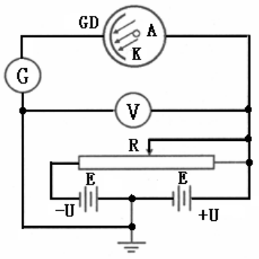

# 光电效应测定普朗克常数预习报告

## 基本信息

- 课程：物理学实验 I
- 实验名称：光电效应测定普朗克常数
- 指导教师：傅悦成
- 班级：软件工程 2502 班
- 姓名：郑逸枫
- 学号：3250105856
- 实验日期：2026 年 10 月 19 日（星期一上午）

# 一、预习报告

## 1. 实验综述

通过预习，我了解到光电效应（photoelectric effect）是物质受到光照后释放电子的现象。光子（photon）的能量为 $h\nu$，电子吸收能量后，一部分用于克服逸出功（work function）$W$，其余成为动能。爱因斯坦光电效应方程为

$$
h\nu=W+\frac{1}{2}mv_{\max}^{2}.
$$

因此，只有频率达到红限频率（threshold frequency）$\nu_0=W/h$ 才可能发生光电子发射；在频率不变时，增强光照主要增加光电子数目，不改变最大初动能。

实验使用 FB807 型光电效应测定仪，由汞灯、滤光片、光阑、光电管及电压和微电流测量装置组成。图中 $K$、$A$ 分别为阴极和阳极，$G$、$V$ 分别测量电流和电压。改变阳极相对阴极的电压 $U_{AK}$，可以测得伏安特性曲线（current–voltage characteristic）。正向电压增大时，电流逐渐达到饱和值；施加反向电压时，光电子受到阻碍，阴极光电流逐渐减小。

将恰好阻止最大初动能电子到达阳极的反向电压大小记为截止电压（stopping potential）$U_a>0$，则

$$
eU_a=\frac{1}{2}mv_{\max}^{2},\qquad U_a=\frac{h}{e}\nu-\frac{W}{e}.
$$

我需要区分仪器显示的负电压 $U_{AK}$ 与用于拟合的正值 $U_a=|U_{AK}|$。对不同单色光分别测量截止电压，用 $\nu=c/\lambda$ 换算频率，再拟合 $U_a=k\nu+b$，可得

$$
h=ek,\qquad W=-eb,\qquad \nu_0=-\frac{b}{k}.
$$

拟合时频率统一用 Hz，电压用 V，所得 $h$ 的单位为 $\mathrm{J\cdot s}$。若横轴用 $10^{14}\,\mathrm{Hz}$ 为单位，则图上斜率须乘 $10^{-14}$ 后才能代入 $h=ek$。截距容易受到接触电势差等因素影响，因此由截距求出的逸出功和红限频率还需结合实际误差讨论。

操作时先检查接线，使汞灯和测试仪预热约 20 分钟，固定光源距离和光阑。关闭光电信号开关后调零，再恢复信号连接，将滤光片转到“0”遮光位置，测量并记录暗电流随电压的变化。测截止电压时，选择 $-4.5\sim+2.5\,\mathrm{V}$ 电压档和 $10^{-13}\,\mathrm{A}$ 电流档，每组测量前重新调零；换上滤光片后，从负电流一侧缓慢调节电压，待电流稳定为零时记录 $U_{AK}$。同时记录滤光片实际波长、光阑孔径和光源距离。

测伏安特性时，将电压档切换到 $-4.5\sim+30\,\mathrm{V}$，电流档选 $10^{-10}\,\mathrm{A}$，重新调零后，逐点记录电压和电流，零电流附近适当加密，绘制不同单色光的伏安曲线。拓展实验固定波长，分别改变距离或孔径，记录饱和电流；在相应近似成立时，检查其与 $1/L^2$ 或孔径平方的关系。

数据处理按课件要求进行线性拟合，记录参数及其标准误差，再评定相关结果的不确定度。与公认值比较得到的相对误差和相对标准不确定度应分别表示为

$$
E=\frac{|h-h_0|}{h_0}\times100\%,\qquad u_r(h)=\frac{u(h)}{|h|}\times100\%.
$$

二者含义不同，不能相互替代。本次预习不填入实测数值；正式处理时还需核实仪器允许误差限，不能将显示分辨力直接当作 B 类不确定度的依据。

## 2. 实验目的

1. 理解光量子概念和爱因斯坦光电效应方程，加深对光的粒子性的认识。
2. 掌握光电效应实验方法，观察截止电压、饱和电流与入射光频率、光强的关系。
3. 通过截止电压与频率的线性关系测定普朗克常数，学习拟合分析与误差讨论。

## 3. 实验重点与难点

1. 准确确定截止电压，注意暗电流和阳极反向电流的影响，根据实际情况选择零电流法或其他方法。
2. 待电流稳定后读数，记录电压正负号和电流量程，换档后重新调零；比较时控制波长、孔径和距离等条件。
3. 勿触摸光学表面，非测量时盖好遮光盖，避免反复开关汞灯。
