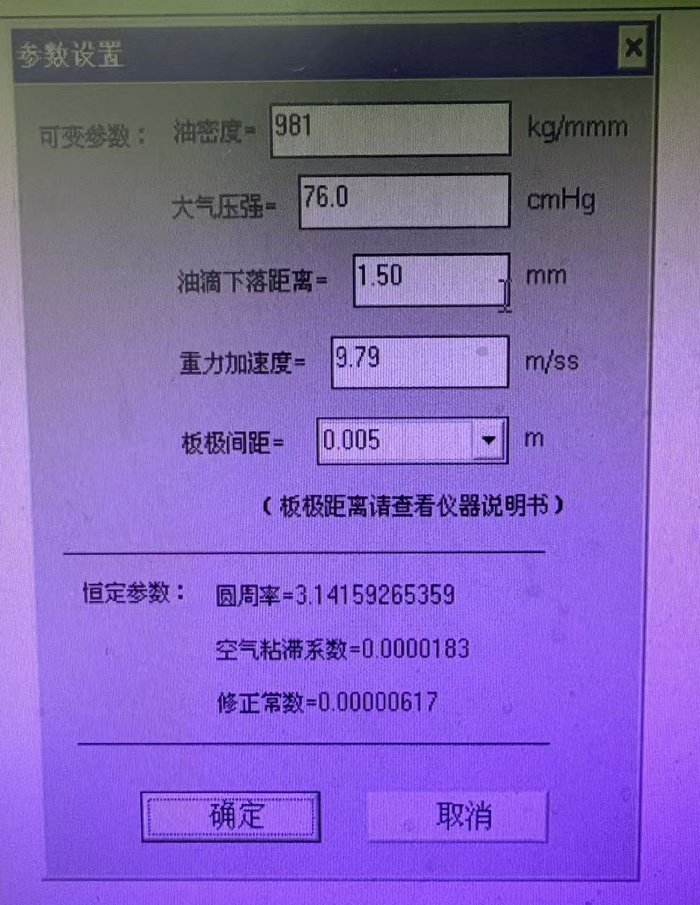
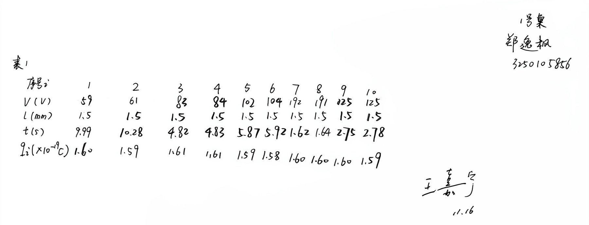
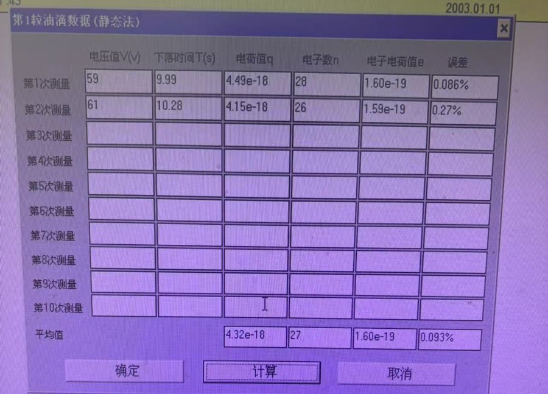
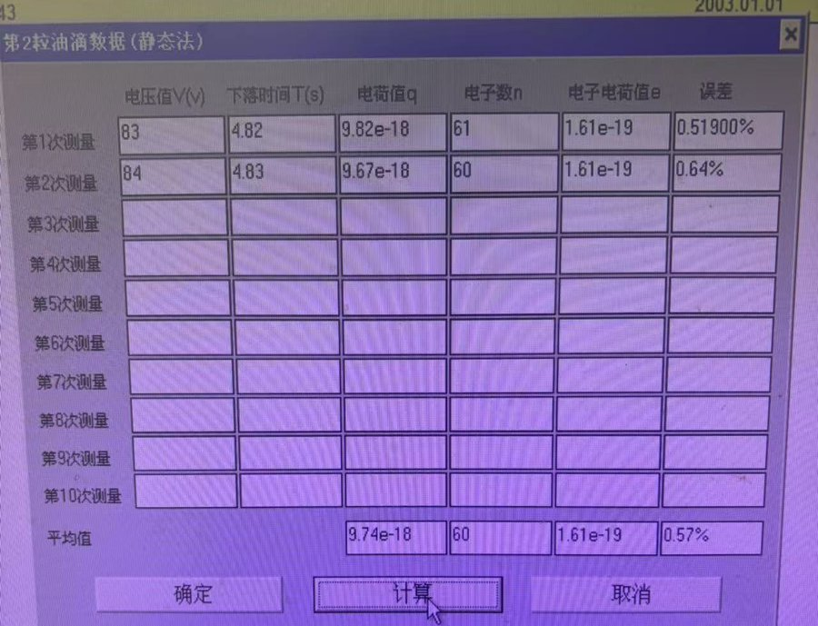
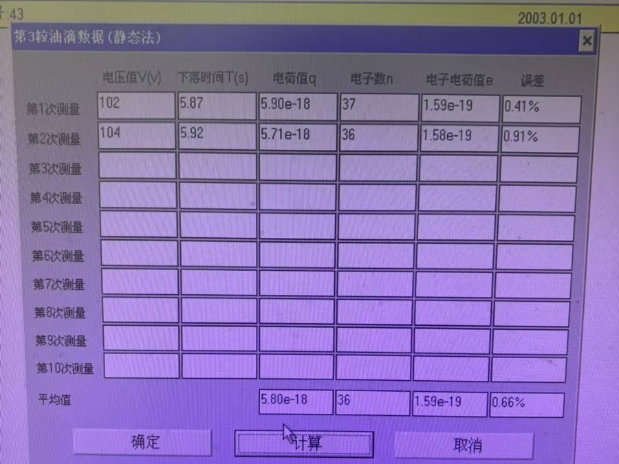
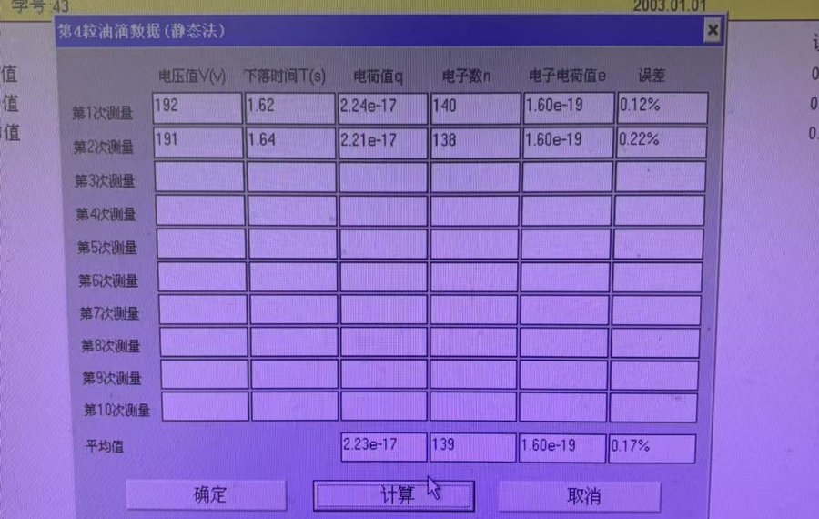
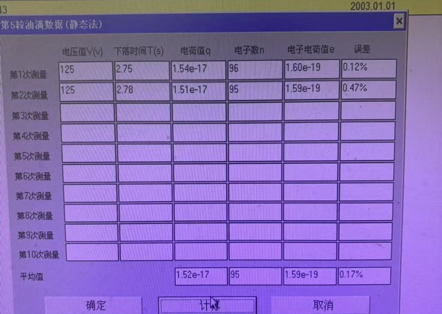
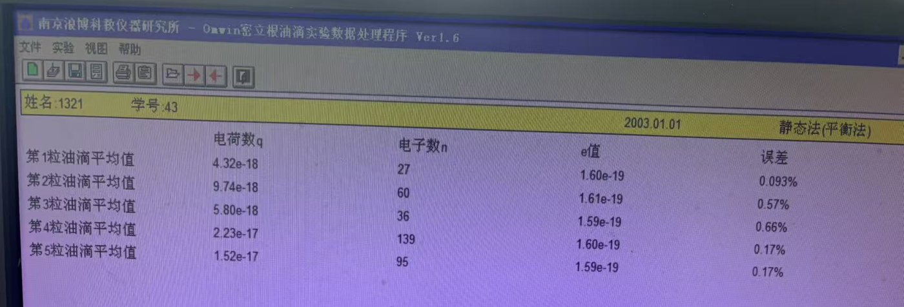

# 密立根油滴实验报告

课程：物理学实验 I；姓名：郑逸枫；学号：3250105856；班级：软件工程2502班；指导教师：王嘉宁；地点：东四112（1号桌）；日期：2026年11月16日星期一上午10:00。

# 一、预习报告

## 1. 实验综述

通过预习，我了解到密立根（R. A. Millikan）利用电场和重力场中运动的带电油滴，测定了基本电荷 $e$，并发现所有带电体的电荷量都是 $e$ 的整数倍，从而证明了电荷的不连续性（量子性）。

本实验采用静态平衡法。油滴喷入间距为 $d$ 的两块水平平行板之间时，因摩擦而带电，所受重力为 $mg$，静电力为 $qE$。调节板间电压 $U$，使油滴静止，则

$$
mg=qE=q\frac{U}{d}.
$$

由于油滴质量很小（约 $10^{-15}\,\mathrm{kg}$），需要用匀速下降法间接测定。油滴在表面张力作用下呈小球状，$m=\frac43\pi r^3\rho$。平行板不加电压时，油滴下落一段距离后，空气黏滞阻力与重力平衡而匀速下降。由斯托克斯定律 $6\pi r\eta v=mg$（忽略空气浮力）得

$$
r=\sqrt{\frac{9\eta v}{2\rho g}}.
$$

对于半径小于 $10^{-6}\,\mathrm{m}$ 的小油滴，空气不能再看作连续介质，黏滞阻力需修正为 $6\pi r\eta v/(1+\frac{b}{pr})$，于是

$$
r=\sqrt{\frac{9\eta v}{2\rho g}\cdot\frac{1}{1+\frac{b}{pr}}}.
$$

修正项中的 $r$ 不需十分精确，可用未修正的结果代入。匀速下降的速度由下降距离 $l$ 和所用时间 $t$ 求出，即 $v=l/t$。将上述各式代入平衡条件，整理得

$$
q=\frac{18\pi}{\sqrt{2\rho g}}\left[\frac{\eta l}{t\left(1+\frac{b}{pr}\right)}\right]^{3/2}\frac{d}{U}.
$$

教材给出的常量为：$g=9.79\,\mathrm{m/s^2}$，$\eta=1.82\times10^{-5}\,\mathrm{N\cdot s/m^2}$，$\rho=981\,\mathrm{kg/m^3}$，$p=1.013\times10^5\,\mathrm{Pa}$，修正常数 $b=6.17\times10^{-6}\,\mathrm{m\cdot cmHg}$，$d=5\,\mathrm{mm}$。注意 $b/(pr)$ 中 $p$ 须以 $\mathrm{cmHg}$ 为单位，即 $p\approx76.0\,\mathrm{cmHg}$。

实验时，我将先调节测量室底座的三个螺钉，使测量室水平，保证电场方向与重力方向平行。接着用喷雾器喷入油滴，调节显微镜焦距，在显示屏上选择合适的油滴：按课件要求，应选带电量小于 10 个基本电荷、平衡电压约 $200\,\mathrm{V}$、下落时间在 $10\,\mathrm{s/mm}$ 以内且清晰可见的油滴。随后练习控制油滴，使它能在视场中上下往复运动。

正式测量时，我将把 K2 拨到“平衡”挡，调节平衡电压使油滴静止，记录 $U$；再拨到“提升”挡，把油滴移到视场上端的刻度线；然后拨到“0V”挡，在油滴匀速下落的一段内计时，记录时间 $t$ 和下落距离 $l$。我计划对同一油滴重复测量，也可换用不同油滴，共记录 10 组数据，再由上式算出各油滴的电荷量 $q_i$。

数据处理将按教材的逐次相减法进行：把 $q_i$ 从小到大排列，求相邻差值 $\Delta q=q_{i+1}-q_i$，由此先估计基本电荷 $e_0$；再由 $q_i/e_0$ 取整得到电荷数 $n_i$，计算 $e_i=q_i/n_i$，最后取平均得到 $e$。课件还给出了平均值法和多重差值法，可用来对照。课件要求求出不确定度，由于最终结果是对多个 $e_i$ 求平均，A 类分量将取 $e_i$ 平均值的标准偏差；B 类分量须以现场仪器给出的允许误差限为准，本次预习不预设数值，也不把显示分辨力当作允许误差限。

## 2. 实验目的

1. 了解密立根油滴仪的结构和工作特性，学会选择和控制油滴。
2. 用静态平衡法测定电子的基本电荷量 $e$，验证电荷的不连续性。
3. 掌握逐次相减法（公约数法）等密立根油滴实验的数据处理方法。

## 3. 实验重点与难点

1. 选择合适的油滴是实验成败的关键。油滴太大，下落太快，不易测准时间，带电量也偏多，相邻电荷数难以区分；油滴太小，则受布朗运动影响明显，下落速度涨落很大。
2. 平衡电压要在油滴确实静止时读取；计时应选在油滴匀速下落的一段，避开起始加速段，起止时刻对准刻度线。跟踪测量时要随时微调焦距，防止油滴变模糊或漂出视场而丢失。
3. 测量前要调平测量室；喷雾适量，避免视场中油滴过多难以辨认。计算时注意 $b/(pr)$ 的单位，并统一换算为国际单位制。

# 二、实验操作与原始数据

## 1. 实验操作与原始记录

实验在 1 号桌进行。我先调平测量室，喷入油滴后调节显微镜焦距，在显示屏上挑选油滴；随后把 K2 依次拨到“平衡”“提升”“0V”挡，记录平衡电压 $U$ 和油滴匀速下落 $l=1.5\,\mathrm{mm}$ 所用的时间 $t$。按本次要求，共测 5 个油滴，每个油滴测量两次。

数据由 Omwin 密立根油滴实验数据处理程序（Ver1.6）记录和计算，参数设置见下图。其中空气黏滞系数取 $1.83\times10^{-5}\,\mathrm{N\cdot s/m^2}$，比教材的 $1.82\times10^{-5}$ 略大，其余参数与教材一致。

原始记录如下。记录表第四行标为 $q_i$，实际抄录的是软件给出的单个电子电荷值 $e$。

<!-- pagebreak -->

## 2. 测量数据

| 序号 $i$ | 1 | 2 | 3 | 4 | 5 | 6 | 7 | 8 | 9 | 10 |
|---|---|---|---|---|---|---|---|---|---|---|
| 油滴编号 | 1 | 1 | 2 | 2 | 3 | 3 | 4 | 4 | 5 | 5 |
| $U$/V | 59 | 61 | 83 | 84 | 102 | 104 | 192 | 191 | 125 | 125 |
| $l$/mm | 1.5 | 1.5 | 1.5 | 1.5 | 1.5 | 1.5 | 1.5 | 1.5 | 1.5 | 1.5 |
| $t$/s | 9.99 | 10.28 | 4.82 | 4.83 | 5.87 | 5.92 | 1.62 | 1.64 | 2.75 | 2.78 |

软件对每次测量给出的电荷值 $q$、电子数 $n$ 和电子电荷值 $e$ 如下。

| 序号 $i$ | 1 | 2 | 3 | 4 | 5 | 6 | 7 | 8 | 9 | 10 |
|---|---|---|---|---|---|---|---|---|---|---|
| $q$/(10⁻¹⁹ C) | 44.9 | 41.5 | 98.2 | 96.7 | 59.0 | 57.1 | 224 | 221 | 154 | 151 |
| $n$ | 28 | 26 | 61 | 60 | 37 | 36 | 140 | 138 | 96 | 95 |
| $e$/(10⁻¹⁹ C) | 1.60 | 1.59 | 1.61 | 1.61 | 1.59 | 1.58 | 1.60 | 1.60 | 1.60 | 1.59 |

## 3. 软件截图

  

 

<!-- pagebreak -->

# 三、结果与分析

## 1. 油滴电荷量

我按教材式（4-10-7）重新计算各次测量的电荷量，常量取软件参数。以第 1 次测量为例，$v=l/t=1.5\times10^{-3}/9.99\,\mathrm{m/s}=1.502\times10^{-4}\,\mathrm{m/s}$，未修正半径

$$
r=\sqrt{\frac{9\eta v}{2\rho g}}=\sqrt{\frac{9\times1.83\times10^{-5}\times1.502\times10^{-4}}{2\times981\times9.79}}\ \mathrm{m}=1.135\ \mu\mathrm{m},
$$

修正项 $b/(pr)=6.17\times10^{-6}/(76.0\times1.135\times10^{-6})=0.0716$，代入得 $q_1=4.490\times10^{-18}\,\mathrm{C}$。十次结果如下，均与软件显示值一致。

| 序号 $i$ | 油滴 | $v$/(mm·s⁻¹) | $r$/μm | $q_i$/(10⁻¹⁹ C) |
|---|---|---|---|---|
| 1 | 1 | 0.1502 | 1.135 | 44.90 |
| 2 | 1 | 0.1459 | 1.119 | 41.54 |
| 3 | 2 | 0.3112 | 1.634 | 98.22 |
| 4 | 2 | 0.3106 | 1.632 | 96.75 |
| 5 | 3 | 0.2555 | 1.480 | 59.04 |
| 6 | 3 | 0.2534 | 1.474 | 57.15 |
| 7 | 4 | 0.9259 | 2.818 | 224.59 |
| 8 | 4 | 0.9146 | 2.800 | 221.59 |
| 9 | 5 | 0.5455 | 2.163 | 154.01 |
| 10 | 5 | 0.5396 | 2.151 | 151.48 |

本次油滴所带电子数为 26～140 个，远多于课件建议的 10 个以内。此时相邻电荷量之差不再接近 $e$，仅凭差值无法唯一确定电子数 $n$。因此三种方法都与软件一致，取 $e_0=1.602\times10^{-19}\,\mathrm{C}$ 作为参考值，由 $q/e_0$ 取整确定 $n$。

## 2. 方法一：平均值法

把电荷量从小到大排列后，同一油滴的两次测量相邻，差值只有 1.5～3.4（单位 10⁻¹⁹ C），远小于不同油滴之间 12～68 的差值，因此按油滴分为 5 组。每组取平均 $\bar q$，再求 $n$ 和 $e_n=\bar q/n$。

| 油滴 | $\bar q$/(10⁻¹⁹ C) | $\bar q/e_0$ | $n$ | $e_n$/(10⁻¹⁹ C) |
|---|---|---|---|---|
| 1 | 43.22 | 26.98 | 27 | 1.6008 |
| 3 | 58.09 | 36.26 | 36 | 1.6137 |
| 2 | 97.49 | 60.85 | 61 | 1.5981 |
| 5 | 152.74 | 95.35 | 95 | 1.6078 |
| 4 | 223.09 | 139.26 | 139 | 1.6050 |

五个 $e_n$ 的平均值 $\bar e=1.6051\times10^{-19}\,\mathrm{C}$，样本标准差 $s=0.0061\times10^{-19}\,\mathrm{C}$。软件总览中第 2 粒油滴显示 $n=60$，是两次 $n$（61、60）平均后取整的结果；按平均值法由 $\bar q/e_0=60.85$ 应取 61。

## 3. 方法二：公约数法

按教材表 4-10-3 的逐次相减法，把 10 个电荷量排序，求相邻差值，再由 $q_i/e_0$ 取整得到 $n_i$，计算 $e_i=q_i/n_i$。这也是软件采用的方法。

| 序号 | 原序号 | $q_i$/(10⁻¹⁹ C) | $\Delta q=q_{i+1}-q_i$ | $n$ 计算值 | $n$ 取整 | $e_i$/(10⁻¹⁹ C) |
|---|---|---|---|---|---|---|
| 1 | 2 | 41.54 | 3.36 | 25.93 | 26 | 1.5978 |
| 2 | 1 | 44.90 | 12.25 | 28.03 | 28 | 1.6036 |
| 3 | 6 | 57.15 | 1.89 | 35.67 | 36 | 1.5875 |
| 4 | 5 | 59.04 | 37.71 | 36.85 | 37 | 1.5956 |
| 5 | 4 | 96.75 | 1.48 | 60.39 | 60 | 1.6124 |
| 6 | 3 | 98.22 | 53.25 | 61.31 | 61 | 1.6102 |
| 7 | 10 | 151.48 | 2.53 | 94.56 | 95 | 1.5945 |
| 8 | 9 | 154.01 | 67.58 | 96.14 | 96 | 1.6043 |
| 9 | 8 | 221.59 | 3.00 | 138.32 | 138 | 1.6057 |
| 10 | 7 | 224.59 | — | 140.19 | 140 | 1.6042 |

十个 $e_i$ 的平均值 $\bar e=1.6016\times10^{-19}\,\mathrm{C}$，$s=0.0076\times10^{-19}\,\mathrm{C}$。

## 4. 方法三：多重差值法

先对排序后的电荷量求一阶差值 $\Delta q_1$，再对 $\Delta q_1$ 求二阶差值 $\Delta q_2=|\Delta q_{1,j+1}-\Delta q_{1,j}|$。课件示例中油滴带电少，差值本身就接近 $e$；本次差值较大，因此每个差值按 $k=\Delta q/e_0$ 取整后计算 $e=\Delta q/k$。

| 序号 $j$ | 1 | 2 | 3 | 4 | 5 | 6 | 7 | 8 | 9 |
|---|---|---|---|---|---|---|---|---|---|
| $\Delta q_1$/(10⁻¹⁹ C) | 3.36 | 12.25 | 1.89 | 37.71 | 1.48 | 53.25 | 2.53 | 67.58 | 3.00 |
| $k$ | 2 | 8 | 1 | 24 | 1 | 33 | 2 | 42 | 2 |
| $e$/(10⁻¹⁹ C) | 1.678 | 1.531 | 1.886 | 1.571 | 1.478 | 1.614 | 1.265 | 1.609 | 1.499 |

| 序号 $j$ | 1 | 2 | 3 | 4 | 5 | 6 | 7 | 8 |
|---|---|---|---|---|---|---|---|---|
| $\Delta q_2$/(10⁻¹⁹ C) | 8.89 | 10.36 | 35.82 | 36.23 | 51.78 | 50.72 | 65.05 | 64.58 |
| $k$ | 6 | 6 | 22 | 23 | 32 | 32 | 41 | 40 |
| $e$/(10⁻¹⁹ C) | 1.482 | 1.727 | 1.628 | 1.575 | 1.618 | 1.585 | 1.587 | 1.615 |

17 个值的平均值 $\bar e=1.585\times10^{-19}\,\mathrm{C}$，$s=0.127\times10^{-19}\,\mathrm{C}$。可以看到，$k$ 只有 1～2 的差值算出的 $e$ 分散很大（1.265～1.886），因为这些差值与测量误差同一量级。

## 5. 结果与不确定度

按教材绪论，对多次得到的 $e$ 取平均，A 类标准不确定度为 $u_A=s/\sqrt N$。电压和计时均由仪器数字显示，现场没有给出它们的允许误差限，因此不评定 B 类分量。

| 方法 | $N$ | $\bar e$/(10⁻¹⁹ C) | $s$/(10⁻¹⁹ C) | $u_A$/(10⁻¹⁹ C) | 测量结果/(10⁻¹⁹ C) | 相对误差 $E$ |
|---|---|---|---|---|---|---|
| 平均值法 | 5 | 1.6051 | 0.0061 | 0.0027 | $1.6051\pm0.0027$ | +0.18% |
| 公约数法 | 10 | 1.6016 | 0.0076 | 0.0024 | $1.6016\pm0.0024$ | −0.04% |
| 多重差值法 | 17 | 1.585 | 0.127 | 0.031 | $1.59\pm0.03$ | −1.05% |

其中 $E=(\bar e-e_{\text{公认}})/e_{\text{公认}}\times100\%$，$e_{\text{公认}}=1.602177\times10^{-19}\,\mathrm{C}$。三种方法的结果分别为

$$
e_1=(1.6051\pm0.0027)\times10^{-19}\ \mathrm{C},
$$

$$
e_2=(1.6016\pm0.0024)\times10^{-19}\ \mathrm{C},
$$

$$
e_3=(1.59\pm0.03)\times10^{-19}\ \mathrm{C}.
$$

平均值法和公约数法与公认值的偏差分别约为 1.1 倍和 0.25 倍不确定度，多重差值法的不确定度最大。不过，前两种方法吻合得好，部分原因在于 $n$ 由 $e_0$ 取整确定：取整后 $e$ 与 $e_0$ 的相对偏差最多为 $1/(2n)$，本次 $n\ge26$，所以 $e_i$ 必然落在 $e_0$ 的 2% 以内。

## 6. 误差分析

1. **油滴带电量偏大。** 本次 $n=26\sim140$，$q_i/e_0$ 偏离整数 0.03～0.44，没有明显集中在整数附近。这说明测量误差已接近一个电子的电荷，数据本身难以独立显示量子化，只能借助 $e_0$ 确定 $n$。
2. **计时误差。** 由 $q\propto t^{-3/2}$，下落时间的相对误差会放大 1.5 倍传到 $q$。第 4 粒油滴下落时间只有约 1.6 s，按键计时的反应误差影响最大。
3. **平衡电压判断。** 平衡电压以整数伏读取，油滴是否完全静止靠肉眼判断，而 $q\propto1/U$。同一油滴两次测量的 $U$ 和 $t$ 都有差别，使两次 $q$ 相差 1.5～3.4（单位 10⁻¹⁹ C），约为 1～2 个电子电荷。
4. **常量取值。** 软件黏滞系数取 $1.83\times10^{-5}$，教材为 $1.82\times10^{-5}$，由 $q\propto\eta^{3/2}$，两者使 $q$ 相差约 0.84%；大气压强固定为 76.0 cmHg，也未按当天实际气温和气压修正。
5. **布朗运动与油滴变化。** 本次油滴半径约 1.1～2.8 μm，较小的油滴受空气分子碰撞会上下抖动，影响平衡判断和计时；测量过程中油滴也可能少量挥发。

# 四、实验心得与思考题

## 1. 实验心得

通过这次实验，我得到了以下收获与心得：

1. 我熟悉了密立根油滴仪“平衡—提升—0V”的操作流程，体会到让一颗油滴在视场中往复运动并保持清晰需要耐心。
2. 选择油滴是关键。本次测得的油滴带电量都偏大（26～140 个电子），处理数据时我才真正理解课件为什么要求带电量小于 10 个基本电荷。
3. 用三种方法处理同一组数据后，我发现平均值法和公约数法结果稳定，而多重差值法在带电量较大时误差明显放大，说明数据处理方法要与数据特点相匹配。
4. 数据处理软件计算方便，但我核对参数后发现其黏滞系数与教材略有不同，也注意到电子数是用参考值取整得到的。使用软件时，仍要清楚它背后的计算过程和假设。

## 2. 思考题

按要求从五道题中任选三题，我选择第 2、3、4 题。

### 2. 为何选油而不用水？

1. 水易蒸发，微米级水滴在测量过程中质量会明显减小，平衡电压和下落速度随之漂移，无法稳定测量。实验用的钟油蒸气压很低，挥发极慢，质量在测量期间基本不变。
2. 钟油的密度已知且稳定，表面张力使油滴保持球形，满足斯托克斯定律的假设，便于由下落速度求半径。
3. 正因为油滴性质稳定，才能长时间跟踪同一颗油滴反复测量，本次每个油滴测两次正是以此为前提。

### 3. 如何从一堆 $q$ 的测量值看出电荷量子化？

1. 把各油滴的 $q$ 从小到大排列，若电荷是量子化的，$q$ 不会连续分布，而是集中在某个最小值的整数倍附近，相邻差值也都接近这个最小值的整数倍。
2. 也可以用 $q/e_0$ 检验：若各值都接近整数，就说明 $q$ 是 $e_0$ 的整数倍。作 $q$ 与 $n$ 的关系图时，各点应落在一条过原点的直线上，斜率即为 $e$。
3. 这种判断要求测量误差明显小于一个电子的电荷，因此应选带电少的油滴。本次 $n=26\sim140$，$q/e_0$ 偏离整数达 0.44，从数据本身看量子化并不明显，这正说明了选取小带电量油滴的必要性。

### 4. 浮力能忽略吗？

1. 考虑空气浮力时，重力应换成 $\frac43\pi r^3(\rho-\rho_{\text{空}})g$。空气密度约 $1.2\,\mathrm{kg/m^3}$，只有钟油密度 $981\,\mathrm{kg/m^3}$ 的约 0.12%。
2. 代入推导可知 $q\propto(\rho-\rho_{\text{空}})^{-1/2}$，忽略浮力只使 $q$ 偏小约 0.06%。
3. 这比本次同一油滴两次测量约 1%～8% 的差别小得多，因此浮力可以忽略。
