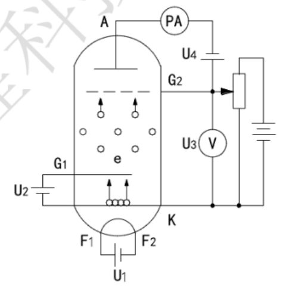
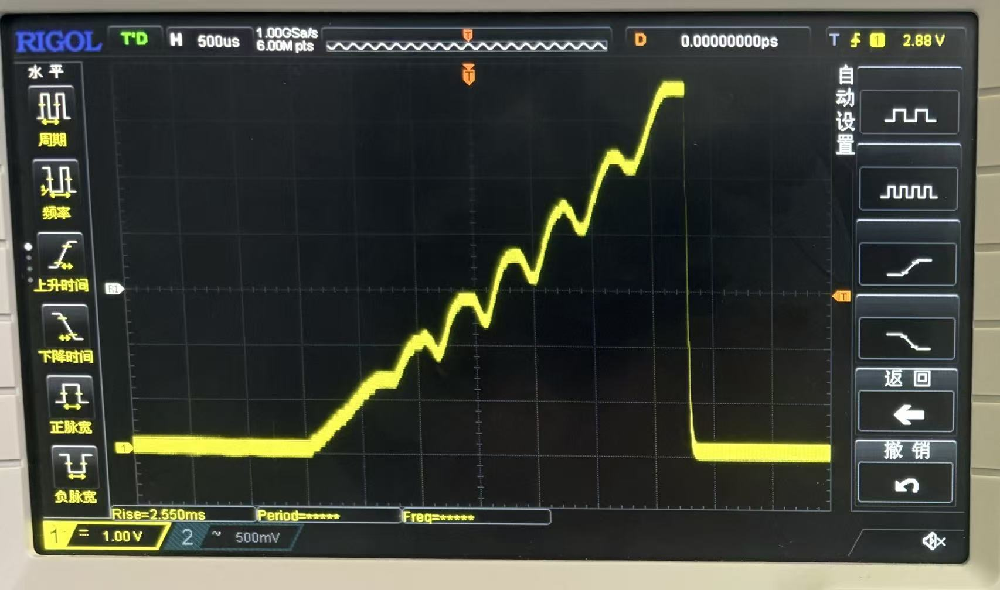
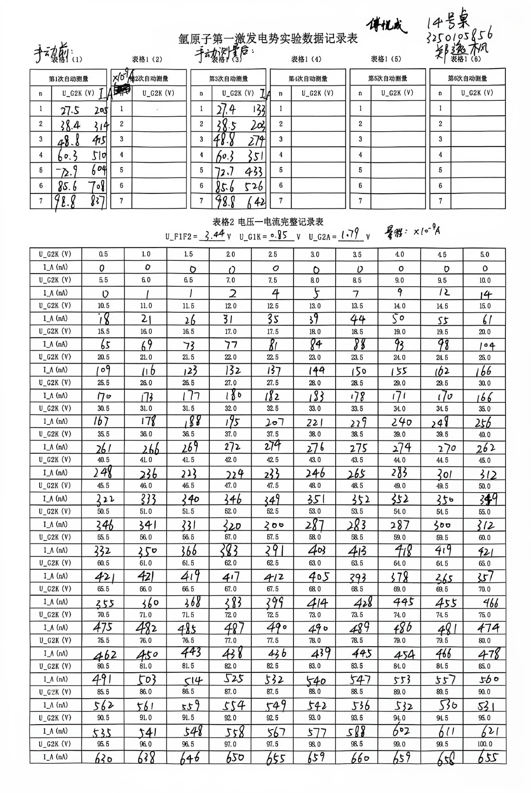
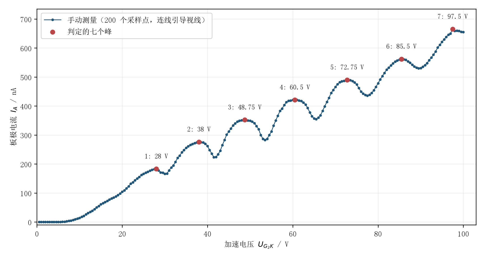
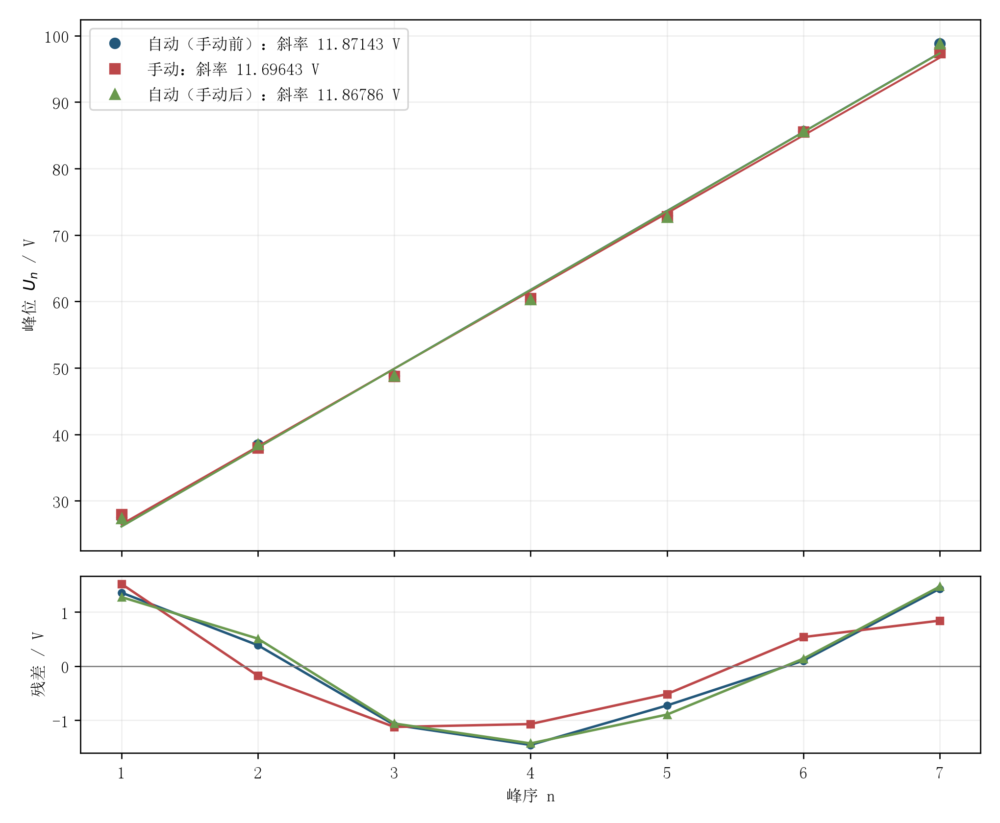

# 浙江大学物理实验报告：弗兰克—赫兹实验

## 基本信息

| 项目 | 内容 |
|---|---|
| 课程 | 物理学实验 I |
| 实验名称 | 弗兰克—赫兹实验 |
| 实验桌号 | 14 号桌 |
| 指导教师 | 傅悦成 |
| 班级 | 软件工程 2502 班 |
| 姓名 | 郑逸枫 |
| 学号 | 3250105856 |
| 实验日期 | 2026 年 10 月 12 日（星期一上午） |

# 一、预习报告

## 1. 实验综述

通过预习，我了解到弗兰克—赫兹实验是用电子与氩原子的碰撞来研究原子能级。电子能量较小时，主要发生弹性碰撞；当能量达到激发阈值，就可能发生非弹性碰撞，把能量传给氩原子，使它从基态跃迁到激发态。

实验中我们将使用 THQFH-2A 型实验仪和示波器。结合原理图，我先梳理了几个电压的作用：灯丝电压 $U_{F_1F_2}$ 用来加热阴极 $K$，使它发射电子；第一栅压 $U_{G_1K}$ 调节电子流，减小空间电荷的影响；加速电压 $U_{G_2K}$ 使电子获得动能；拒斥电压 $U_{G_2A}$ 则阻止剩余动能不足的电子到达板极 $A$。

图 1：弗兰克—赫兹实验原理图。

其中电流出现峰谷的关键在于电子碰撞后能否克服拒斥电场到达板极。随着加速电压增大，电子经历非弹性碰撞后损失能量，板极电流下降；继续升高电压，电流又回升，从而形成一系列峰谷。同类相邻极值的电压间隔近似等于激发电势 $U_0$，对应的能量差满足

$$
eU_0=\Delta E.
$$

数据处理时，我需要注意测量的是峰之间的电压间隔，而不是第一个峰对应的电压，因为接触电势差会使曲线整体偏移。若一次测量记录了七个峰值电压 $V_1,\ldots,V_7$，就把前三个峰与后三个峰配对，用逐差法求出

$$
U_0=\frac{(V_5-V_1)+(V_6-V_2)+(V_7-V_3)}{3\times4}.
$$

这三组配对峰都相隔四个级次，所以求出电压差的平均值后，还要除以 4。实验中计划完成六次自动测量，每次得到一个 $U_0^{(j)}$，最后取平均值：

$$
\overline{U_0}=\frac{1}{6}\sum_{j=1}^{6}U_0^{(j)}.
$$

预备操作是先完成接线、预热、调零，再按实验管的参数标签设置各电压。第一个实验只需要自动测量，先调好示波器量程和外触发，切换到自动方式并按“确认”键启动；约 4 分钟后，用查询键依次读取峰值，将每次的峰值序号和对应加速电压（单位 V）记录在表中，最后求激发电势。第二个实验要求手动测量，将实验仪切换到手动测量方式后，缓慢增大加速电压，每隔 0.5 V、待电流稳定约 4 秒后读数；把电压（V）与电流（nA）成对记录，再绘制电流—电压曲线。

## 2. 实验目的

1. 通过观察电流的变化，加深对弹性碰撞和非弹性碰撞的理解。
2. 观察板极电流随加速电压变化的峰谷曲线，理解它为什么能说明原子能级是离散的。
3. 学习实验仪和示波器的使用方法，并用逐差法测定氩原子的激发电势。

## 3. 实验重点与难点

1. 接线时，要特别留意加速电压和拒斥电压的极性。通电前先将各电压旋钮逆时针旋到底，检查接线无误后再开机，预热约 15 分钟，并将微电流测量仪调零。
2. 调出清晰的峰谷曲线是需要关注的重点。灯丝电压过大可能使放大器饱和，过小则峰谷不明显；拒斥电压过小不能有效筛选电子，过大又会使电流太小。因此，我先按实验管上的参数标签设置电压，再观察曲线、适当调整。
3. 操作时注意保护实验管：灯丝电压不能比参数标签的参考值高出 0.5 V，连续工作不超过 2 小时。如果电流突然剧增，应立即降低加速电压和灯丝电压。实验结束后关闭电源，整理好导线。

# 二、实验操作与原始数据

## 1. 实际实验标准与测量顺序

一切操作和数据处理按照上课课件标准处理。上文完整保留课前预习报告，作为预习记录；其中的六次自动测量计划和逐差法来自预习讲义，与上课要求不同，不作为本次实际测量次数和正式数据处理方法。

课堂要求完成一组自动七峰记录及一次完整的手动电压—电流测量，绘制手动曲线判定峰位，再对自动、手动两组峰位分别作线性拟合，报告激发电势、相关系数、斜率标准不确定度和相对误差。

本次我在手动测量之前、之后各进行了一次自动测量，因此实际顺序为“自动前测—手动测量—自动后测”。因为手动测量耗时较长，期间装置的热状态会发生漂移，因此有必要保留前后两组自动记录作对照。

## 2. 仪器参数与操作记录

本台实验仪给出的三项电压参数及电流挡位如下：

| 项目 | 本次记录 |
|---|---|
| 灯丝电压 $U_{F_1F_2}$ | $3.44\ \mathrm V$ |
| 第一栅压 $U_{G_1K}$ | $0.85\ \mathrm V$ |
| 拒斥电压 $U_{G_2A}$ | $1.79\ \mathrm V$ |
| 微电流测量挡位 | $\times10^{-9}\ \mathrm A$，电流记为 nA |
| 手动加速电压范围与步长 | $0.5\text{--}100.0\ \mathrm V$，每步 $0.5\ \mathrm V$ |

首先完成接线、预热和微电流调零，按本台参数设置各电压，观察波形并调整显示，使峰谷能分辨。通电和调节过程中注意电压极性及实验管保护，避免电流突然剧增或微电流放大器过载。

第一次自动测量在手动测量前进行。切换实验仪到自动方式并启动扫描，观察示波器波形；测量结束后按峰序查询，把七个峰的加速电压和峰电流逐一记录。

随后切换到手动方式，从 0.5 V 起逐步增大加速电压，每隔 0.5 V 读取一组电压、电流，等待示数稳定后记录，直至 100.0 V，得到 200 个采样点。由于手动测量花费时间明显比一次自动扫描长，热电子发射和装置温度可能变化，不能把这 200 个点简单视为同一瞬间的扫描曲线。

手动测量结束后再次进行自动扫描，以相同的峰序记录七个峰位及峰电流，便于误差分析时考虑热漂移、读数稳定性及仪器工作状态的影响。

## 3. 原始记录与转录说明

下图为本次原始数据。原表第 1 栏为“手动测量前”自动挡测得数据，第 3 栏为“手动测量后”自动挡测得数据。

## 4. 自动测量七峰记录

| 峰序 $n$ | 前测峰位/V | 前测峰电流/nA | 后测峰位/V | 后测峰电流/nA |
|---:|---:|---:|---:|---:|
| 1 | 27.5 | 205 | 27.4 | 133 |
| 2 | 38.4 | 314 | 38.5 | 203 |
| 3 | 48.8 | 415 | 48.8 | 274 |
| 4 | 60.3 | 510 | 60.3 | 351 |
| 5 | 72.9 | 604 | 72.7 | 433 |
| 6 | 85.6 | 708 | 85.6 | 526 |
| 7 | 98.8 | 837 | 98.8 | 642 |

## 5. 完整手动电压—电流记录

| $U$/V | $I$/nA | $U$/V | $I$/nA | $U$/V | $I$/nA | $U$/V | $I$/nA |
|---:|---:|---:|---:|---:|---:|---:|---:|
| 0.5 | 0 | 25.5 | 170 | 50.5 | 346 | 75.5 | 462 |
| 1.0 | 0 | 26.0 | 173 | 51.0 | 341 | 76.0 | 450 |
| 1.5 | 0 | 26.5 | 177 | 51.5 | 331 | 76.5 | 443 |
| 2.0 | 0 | 27.0 | 180 | 52.0 | 320 | 77.0 | 438 |
| 2.5 | 0 | 27.5 | 182 | 52.5 | 300 | 77.5 | 436 |
| 3.0 | 0 | 28.0 | 183 | 53.0 | 287 | 78.0 | 439 |
| 3.5 | 0 | 28.5 | 178 | 53.5 | 283 | 78.5 | 445 |
| 4.0 | 0 | 29.0 | 171 | 54.0 | 287 | 79.0 | 454 |
| 4.5 | 0 | 29.5 | 170 | 54.5 | 300 | 79.5 | 466 |
| 5.0 | 0 | 30.0 | 166 | 55.0 | 312 | 80.0 | 478 |
| 5.5 | 0 | 30.5 | 167 | 55.5 | 332 | 80.5 | 491 |
| 6.0 | 1 | 31.0 | 178 | 56.0 | 350 | 81.0 | 503 |
| 6.5 | 1 | 31.5 | 188 | 56.5 | 366 | 81.5 | 514 |
| 7.0 | 2 | 32.0 | 195 | 57.0 | 383 | 82.0 | 525 |
| 7.5 | 4 | 32.5 | 207 | 57.5 | 391 | 82.5 | 532 |
| 8.0 | 5 | 33.0 | 221 | 58.0 | 403 | 83.0 | 540 |
| 8.5 | 7 | 33.5 | 229 | 58.5 | 413 | 83.5 | 547 |
| 9.0 | 9 | 34.0 | 240 | 59.0 | 418 | 84.0 | 553 |
| 9.5 | 12 | 34.5 | 248 | 59.5 | 419 | 84.5 | 557 |
| 10.0 | 14 | 35.0 | 256 | 60.0 | 421 | 85.0 | 560 |
| 10.5 | 18 | 35.5 | 261 | 60.5 | 421 | 85.5 | 562 |
| 11.0 | 21 | 36.0 | 266 | 61.0 | 421 | 86.0 | 561 |
| 11.5 | 26 | 36.5 | 269 | 61.5 | 419 | 86.5 | 559 |
| 12.0 | 31 | 37.0 | 272 | 62.0 | 417 | 87.0 | 554 |
| 12.5 | 35 | 37.5 | 274 | 62.5 | 412 | 87.5 | 549 |
| 13.0 | 39 | 38.0 | 276 | 63.0 | 405 | 88.0 | 542 |
| 13.5 | 44 | 38.5 | 275 | 63.5 | 393 | 88.5 | 536 |
| 14.0 | 50 | 39.0 | 274 | 64.0 | 378 | 89.0 | 532 |
| 14.5 | 55 | 39.5 | 270 | 64.5 | 365 | 89.5 | 530 |
| 15.0 | 61 | 40.0 | 262 | 65.0 | 357 | 90.0 | 531 |
| 15.5 | 65 | 40.5 | 248 | 65.5 | 355 | 90.5 | 535 |
| 16.0 | 69 | 41.0 | 236 | 66.0 | 360 | 91.0 | 541 |
| 16.5 | 73 | 41.5 | 223 | 66.5 | 368 | 91.5 | 548 |
| 17.0 | 77 | 42.0 | 224 | 67.0 | 383 | 92.0 | 558 |
| 17.5 | 81 | 42.5 | 233 | 67.5 | 399 | 92.5 | 567 |
| 18.0 | 84 | 43.0 | 246 | 68.0 | 414 | 93.0 | 577 |
| 18.5 | 88 | 43.5 | 265 | 68.5 | 428 | 93.5 | 588 |
| 19.0 | 93 | 44.0 | 283 | 69.0 | 445 | 94.0 | 602 |
| 19.5 | 98 | 44.5 | 301 | 69.5 | 455 | 94.5 | 611 |
| 20.0 | 104 | 45.0 | 312 | 70.0 | 466 | 95.0 | 621 |
| 20.5 | 109 | 45.5 | 322 | 70.5 | 475 | 95.5 | 630 |
| 21.0 | 116 | 46.0 | 333 | 71.0 | 482 | 96.0 | 638 |
| 21.5 | 123 | 46.5 | 340 | 71.5 | 485 | 96.5 | 646 |
| 22.0 | 132 | 47.0 | 346 | 72.0 | 487 | 97.0 | 650 |
| 22.5 | 137 | 47.5 | 349 | 72.5 | 490 | 97.5 | 665 |
| 23.0 | 144 | 48.0 | 351 | 73.0 | 490 | 98.0 | 659 |
| 23.5 | 150 | 48.5 | 352 | 73.5 | 489 | 98.5 | 660 |
| 24.0 | 155 | 49.0 | 352 | 74.0 | 486 | 99.0 | 659 |
| 24.5 | 162 | 49.5 | 350 | 74.5 | 481 | 99.5 | 656 |
| 25.0 | 166 | 50.0 | 349 | 75.0 | 474 | 100.0 | 655 |

# 三、结果与分析

## 1. 手动曲线与峰位判定

以实测加速电压为横轴、板极电流为纵轴作图。完整电流曲线有周期性峰谷，不能用一条直线拟合整条电流—电压曲线；课堂要求的线性拟合是对“峰序—峰位”进行的。图中采样点间的线段仅用于显示走势，没有改变实测数据。

低压段电流接近零，随后逐渐上升，在约 28 V 后开始呈现明显的峰谷。各峰的电流基线随电压总体上升，对有单个最大采样点的峰，采用该点的电压；若相邻多个采样点的电流同为最大值，则保留峰顶区间，以区间中点作为代表峰位。

| 峰序 $n$ | 最大值所在电压/V | 代表峰位 $U_n$/V | 峰电流/nA |
|---:|---:|---:|---:|
| 1 | 28.0 | 28.00 | 183 |
| 2 | 38.0 | 38.00 | 276 |
| 3 | 48.5—49.0 | 48.75 | 352 |
| 4 | 60.0—61.0 | 60.50 | 421 |
| 5 | 72.5—73.0 | 72.75 | 490 |
| 6 | 85.5 | 85.50 | 562 |
| 7 | 97.5 | 97.50 | 665 |

## 2. 峰序—峰位线性拟合

按课堂要求，对每组七个峰分别作普通最小二乘线性拟合：

$$
U_n=A+n\Delta U,\qquad n=1,\ldots,7.
$$

其中 $\Delta U$ 是拟合斜率，代表相邻峰的平均电压间隔，作为本次测得的有效激发电势；$A$ 是拟合截距，吸收接触电势、拒斥筛选及峰序定义等引起的整体偏移。
令 $\bar n=4$、$\bar U=N^{-1}\sum U_n$，定义中心化和量

$$
S_{nn}=\sum(n-\bar n)^2=28,
\quad S_{UU}=\sum(U_n-\bar U)^2,
\quad S_{nU}=\sum(n-\bar n)(U_n-\bar U).
$$

则

$$
\Delta U=\frac{S_{nU}}{S_{nn}},\qquad
A=\bar U-\Delta U\bar n,\qquad
r=\frac{S_{nU}}{\sqrt{S_{nn}S_{UU}}}.
$$

本次三组峰位均使用 $N=7$，自由度为 $N-2=5$。下表保留计算中间位数用于复核，最终结果按不确定度修约。

| 数据组 | $A$/V | $\Delta U$/V | 相关系数 $r$ | $R^2$ |
|---|---:|---:|---:|---:|
| 自动前测 | 14.27143 | 11.87143 | 0.999004 | 0.998008 |
| 手动测量 | 14.78571 | 11.69643 | 0.999217 | 0.998434 |
| 自动后测 | 14.25714 | 11.86786 | 0.998984 | 0.997969 |

三条拟合式为

$$
\begin{aligned}
U_n^{\text{前}}/\mathrm V&=14.27143+11.87143n,\\
U_n^{\text{手}}/\mathrm V&=14.78571+11.69643n,\\
U_n^{\text{后}}/\mathrm V&=14.25714+11.86786n.
\end{aligned}
$$

1. 三组相关系数均大于 0.998，峰位随峰序近似线性增加，支持激发能量具有确定的尺度。
2. 残差并非完全随机，自动的两组在两端偏正、中间偏负，均有约 1.4 V 的偏离，说明峰间距还有随峰序变化的趋势。
3. 较大的 $r$ 主要说明整体线性关系强，效果较理想。

## 3. 斜率标准不确定度与结果表达

课上给出由相关系数计算斜率标准不确定度的方法：

$$
u(\Delta U)=|\Delta U|\sqrt{\frac{1/r^2-1}{N-2}}.
$$

计算得出：
| 数据组 | 残差平方和/V² | $u(\Delta U)$/V | 相对标准不确定度 |
|---|---:|---:|---:|
| 自动前测 | 7.874286 | 0.237160 | 2.00% |
| 手动测量 | 6.008929 | 0.207174 | 1.77% |
| 自动后测 | 8.025357 | 0.239424 | 2.02% |

保留两位有效数字，正式结果为：

$$
\boxed{\Delta U_{\text{前}}=(11.87\pm0.24)\ \mathrm V},
$$

$$
\boxed{\Delta U_{\text{手}}=(11.70\pm0.21)\ \mathrm V},
$$

$$
\boxed{\Delta U_{\text{后}}=(11.87\pm0.24)\ \mathrm V}.
$$

未知电压表和微电流测量的允许误差限，因此不评定 B 类分量。

## 4. 与参考值比较

采用实验教材附录使用的有效激发电势 $U_{\text{ref}}=11.61\ \mathrm V$ 作为比较值。
$$
\delta=\frac{|\Delta U-11.61\ \mathrm V|}{11.61\ \mathrm V}\times100\%.
$$

| 数据组 | $\Delta U$/V（未修约） | 相对误差 |
|---|---:|---:|
| 自动前测 | 11.87143 | 2.25% |
| 手动测量 | 11.69643 | 0.74% |
| 自动后测 | 11.86786 | 2.22% |

## 5. 误差分析

### 5.1 温度漂移与前后自动测量

手动测量之后我发现在相等第二栅压的情况下，手动挡测得的电流平均比最初自动挡测得的电流小22%，思考后认为是因为手动测量耗时较长，装置持续工作时的温度漂移可能改变热电子发射和空间电荷分布，影响电流大小及峰谷形状。

因此，我在手动测量后再进行了一次自动测量作对照。发现后一次自动测量的峰值电流与手动测量的峰值电流大小基本一致，所以基本可以确认是因为手动挡操作时间长，仪器温度上升导致的误差。
但是，每一次测量算出的激发电势与参考值的相对误差都控制在2.25%以内，都是有效的测量。

### 5.2 峰位判定与采样步长

手动峰顶较宽，第 3、4、5 峰出现平顶，精确极值不一定落在采样点上。取平均值是折中的方法，却仍然无法避免测量误差。

### 5.3 读数稳定性

手动挡各点第二栅压电压需要手动调整，可能存在微小差别导致测量误差。同时，如果在电流示数没有稳定时过早读数，也会导致测量误差。

# 四、实验探讨与思考题

## 1. 实验小结

本次实验按课堂要求完成手动前后两次自动测量，以及一次覆盖 0.5—100.0 V 的完整手动测量。从手动曲线上判出七个峰，以峰序与峰位作线性拟合，得到自动前测、手动测量和自动后测的有效激发电势分别为 $(11.87\pm0.24)\ \mathrm V$、$(11.70\pm0.21)\ \mathrm V$ 和 $(11.87\pm0.24)\ \mathrm V$，相对参考值 11.61 V 的误差分别为 2.25%、0.74% 和 2.22%。各不确定度仅为拟合标准不确定度。

电流曲线出现一系列峰谷，峰位与峰序近似呈线性关系，说明电子与氩原子的非弹性碰撞存在确定的能量交换尺度，与原子能级离散的解释相符。同时，不能把第一峰电压直接当作激发电势，不能因相关系数接近 1 就忽略峰位判定和系统误差。

额外增加第二次自动测量，是为了验证温度漂移导致了电流测量误差。结果确实有助于验证误差猜想，这也提示我们实验应在充分预热后测量，但也需要在尽可能短的时间内完成手动测量，来避免温度上升导致的温度漂移。

## 2. 思考题

### 2.1 第一激发电位的物理含义是什么？

第一激发电位是以电势差表示原子发生最低激发所需的能量尺度。在理想情况下，电子经过电势差 $U_0$ 加速后获得动能 $eU_0$；当它与基态原子发生非弹性碰撞时，可以把这部分能量传给原子，使原子跃迁到可被激发的最低能态，因此有 $\Delta E=eU_0$。它反映原子内部能级差，而不是电子被电离所需的电离能。

### 2.2 温度对 F-H 管的电流—加速电压曲线有什么影响？

温度变化会影响阴极的热电子发射：发射电子的数量和初始能量分布改变后，电流基线、峰谷高度及峰宽也会变化。温度若在测量期间持续漂移，前后不同采样点便对应不同工作状态，可能使手动曲线的形状或峰位判定产生偏差。灯丝发射过强还可能使放大器饱和；发射不足则峰谷不明显。

### 2.3 第一个电流峰对应的加速电压为什么不能直接作为氩原子的第一激发电势？

仪器显示的加速电压不全部对应电子用于激发原子的净动能。不同电极材料引起的接触电势、电子的初始能量、空间电荷和拒斥电场筛选都会影响第一峰的位置；而电流峰值是电子群体在特定碰撞和收集条件下形成的极大值，不是一个理想电子刚达到激发阈值的时刻。
而且本次第一峰在约 27—28 V，而拟合激发电势约为 11.7—11.9 V，两者明显不同。使用 $U_n=A+n\Delta U$ 拟合才能测得较准确的激发电势。
