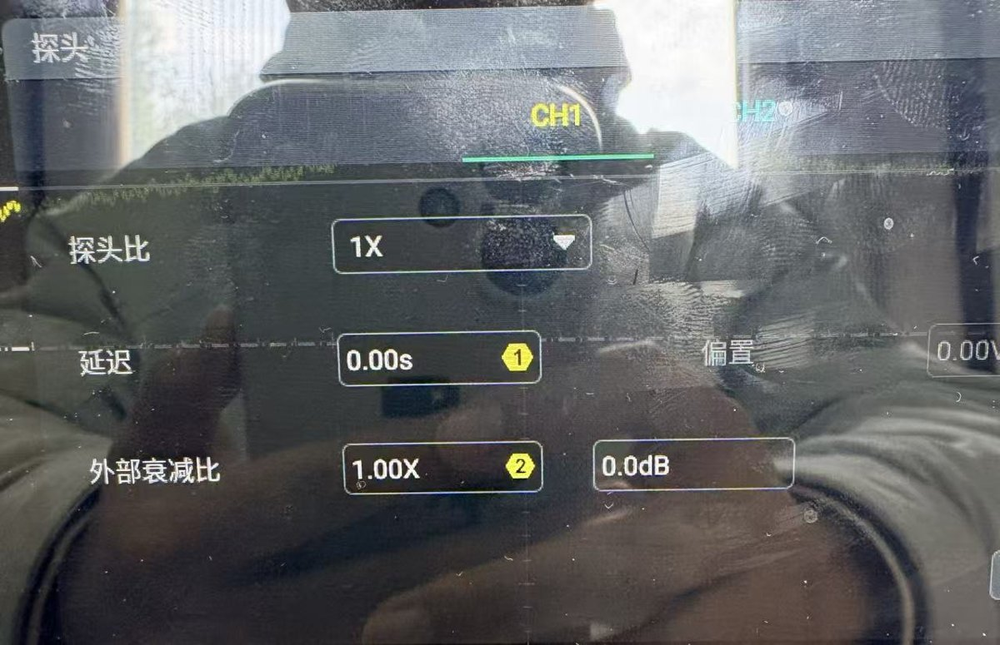
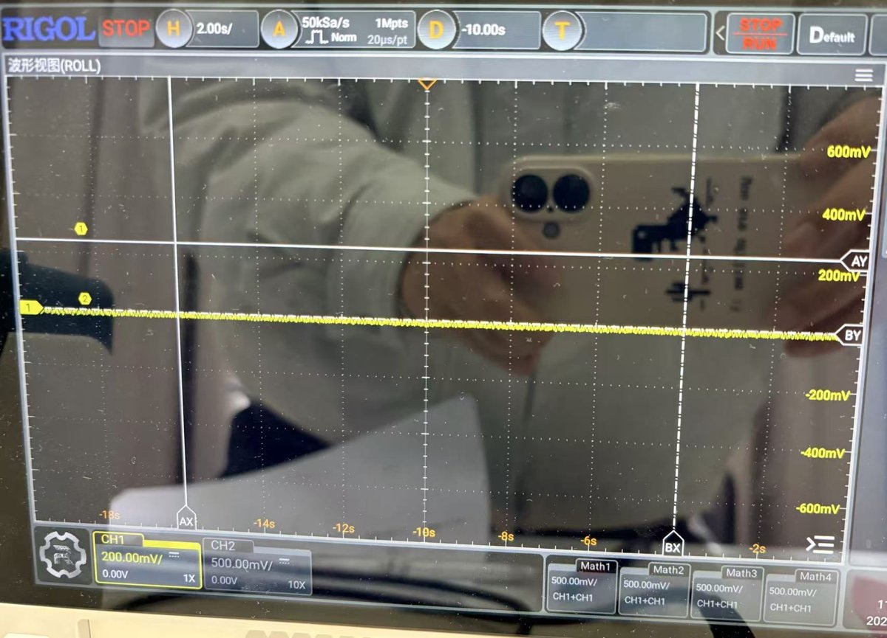
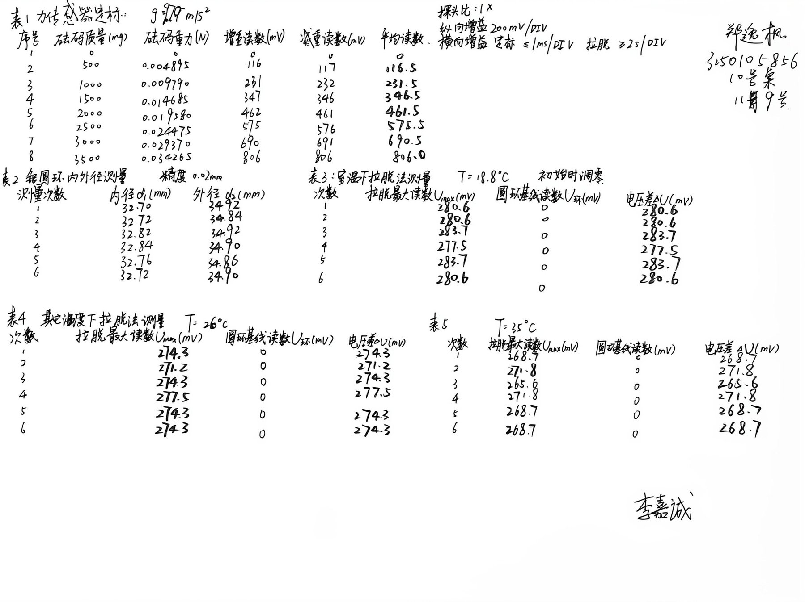
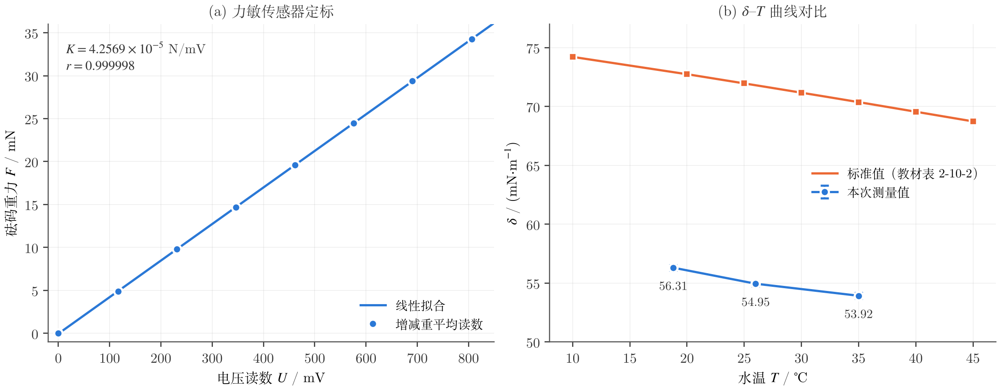

# 液体表面张力系数测定实验报告

课程：物理学实验 I；姓名：郑逸枫；学号：3250105856；班级：软件工程2502班；指导教师：李嘉诚；地点：东四239（10号桌）；日期：2026年11月9日星期一上午10:00。

# 一、预习报告

## 1. 实验综述

通过预习，我了解到液体表面层中的分子比内部稀疏，分子间作用表现为引力，使液面具有收缩的趋势，这就是表面张力（surface tension）。在液面上任取一条长为 $l$ 的分界线，两侧液面的相互拉力与分界线垂直、与液面相切，且满足

$$
f=\delta\, l,
$$

其中 $\delta$ 为表面张力系数，单位为 $\mathrm{N/m}$。它与液体的成分、纯度和温度有关，温度升高时 $\delta$ 减小。

本实验采用拉脱法（ring method）。实验中将把外径为 $D_1$、内径为 $D_2$ 的金属圆环挂在力敏传感器下并浸入水中，再缓慢降低液面，圆环内外两侧会带起一层液膜。液膜即将破裂时接触角 $\theta$ 很小，取 $\cos\theta\approx1$，并忽略浮力，则圆环所受拉力为

$$
F=mg+\pi\delta(D_1+D_2),\qquad \delta=\frac{F-mg}{\pi(D_1+D_2)}.
$$

力敏传感器由四个力敏电阻组成电桥，外力使电桥失去平衡，输出电压的变化与外力成正比，即 $k\Delta U=F-mg$，其中 $k$ 为传感器灵敏度（单位 $\mathrm{N/V}$）。因此

$$
\delta=\frac{k\,\Delta U}{\pi(D_1+D_2)}.
$$

由于圆环有一定厚度，液膜被拉起后先接近竖直，随后向内收缩，拉力在达到最大值后略有下降，最后在破裂瞬间骤降。所以电压差应取最大拉力对应的读数 $U_1$ 与液膜破裂后读数 $U_2$ 之差，即 $\Delta U=U_1-U_2$，而不是破裂瞬间前后的差值。

实验时，我将先打开变温界面张力分析仪充分预热（课件建议 15 分钟以上），并用水准泡将测试架调平。挂上砝码盘后将拉力置零，然后按 $0.500\,\mathrm{g}$ 逐个增加砝码至 $3.500\,\mathrm{g}$，再逐个减少至 $0$，分别记录电压。增减两次读数取平均，可以减小传感器滞后的影响；重力将按杭州 $g=9.79\,\mathrm{m/s^2}$ 换算，再作 $U$–$F$ 线性拟合，斜率的倒数即为 $k$。随后我将用游标卡尺在不同方向各测 6 次圆环外径 $D_1$ 和内径 $D_2$。

正式测量前，我将先用净水洗净圆环和加热器皿，再注入待测的水。挂上圆环并将拉力置零后，调节升降台使环底刚好接触液面，将位移置零，继续上升至位移约 $2\sim2.5\,\mathrm{mm}$，再缓慢下降，每隔 $0.05\,\mathrm{mm}$ 记录一次拉力电压，直至液膜被拉破，以观察拉力随位移的变化。同时我将用示波器（$200\,\mathrm{mV/DIV}$，时基 $2\,\mathrm{s/DIV}$ 或更大）记录拉力曲线，液膜破裂后按 STOP 暂停，用光标读取 $U_1$ 和 $U_2$。室温下计划重复测量 6 次；之后将用温控表使水温在室温基础上升高 $15\sim25\,{}^\circ\mathrm{C}$，待温度稳定后重复测量，并与标准值比较。

数据处理将按课件要求进行：由线性拟合得到 $k$ 及其标准差，并以 3 倍标准差估计 $k$ 的不确定度；$D_1$、$D_2$ 和 $\Delta U$ 将取多次测量的平均值并评定 A 类不确定度，游标卡尺的 B 类分量取其允许误差限 $\Delta=0.02\,\mathrm{mm}$，按均匀分布有 $u_B=\Delta/\sqrt3$。最后按传导法则合成

$$
\frac{u(\delta)}{\delta}=\sqrt{\left(\frac{u(k)}{k}\right)^{2}+\left(\frac{u(\Delta U)}{\Delta U}\right)^{2}+\frac{u^{2}(D_1)+u^{2}(D_2)}{(D_1+D_2)^{2}}}.
$$

电压读数的 B 类分量将以现场仪器给出的允许误差限为准，不能把显示分辨力直接当作允许误差限；本次预习不填入实测数值。

## 2. 实验目的

1. 了解液体表面的性质，掌握拉脱法测量表面张力系数的原理和方法。
2. 学习力敏传感器的使用和砝码定标方法，掌握微小力的测量。
3. 测定水的表面张力系数，了解其随温度的变化，并学习不确定度的分析。

## 3. 实验重点与难点

1. 定标时要保持测试架水平，砝码轻放，待示数稳定后读数；增、减砝码各测一遍，检查传感器的线性和滞后。
2. 圆环和器皿必须洗净，圆环应保持水平；降低液面要缓慢，避免震动。读数时要正确识别最大拉力 $U_1$ 和破裂后的 $U_2$，不能过早读数，也不能取破裂瞬间前后的差值。
3. 加热后器皿温度较高，须防止烫伤；待水温稳定后再测量。实验结束先关加热电源，再关总电源，并用干布擦干仪器。

# 二、实验操作与原始数据

## 1. 实验操作与原始记录

实验时，我先打开变温界面张力分析仪预热，用水准泡将测试架调平，再按课堂要求设置示波器：探头比 1×，纵向增益 $200\,\mathrm{mV/DIV}$；定标时横向增益不大于 $1\,\mathrm{ms/DIV}$，拉脱时不小于 $2\,\mathrm{s/DIV}$，采用光标读数。下面两张照片是调试时的探头设置和示波器参数。

定标时，挂上砝码盘并将拉力置零，以 $500\,\mathrm{mg}$ 为一档逐个加砝码至 $3500\,\mathrm{mg}$，再逐个减少，分别记录电压。随后取下砝码盘，用游标卡尺在不同方向各测 6 次圆环的内径 $d_1$ 和外径 $d_2$。

拉脱测量前，我挂上圆环并在初始时调零，此后圆环基线读数均记为 0。室温 $18.8\,{}^\circ\mathrm{C}$ 下测量 6 次，再将水温升至 $26\,{}^\circ\mathrm{C}$ 和 $35\,{}^\circ\mathrm{C}$，各测 6 次。原始记录如下。

<!-- pagebreak -->

## 2. 力敏传感器定标数据

取杭州重力加速度 $g=9.79\,\mathrm{m/s^2}$，平均读数为增重与减重读数的平均值。

| 序号 | 砝码质量/mg | 砝码重力/N | 增重读数/mV | 减重读数/mV | 平均读数/mV |
|---|---|---|---|---|---|
| 1 | 0 | 0 | 0 | 0 | 0 |
| 2 | 500 | 0.004895 | 116 | 117 | 116.5 |
| 3 | 1000 | 0.009790 | 231 | 232 | 231.5 |
| 4 | 1500 | 0.014685 | 347 | 346 | 346.5 |
| 5 | 2000 | 0.019580 | 462 | 461 | 461.5 |
| 6 | 2500 | 0.024475 | 575 | 576 | 575.5 |
| 7 | 3000 | 0.029370 | 690 | 691 | 690.5 |
| 8 | 3500 | 0.034265 | 806 | 806 | 806.0 |

## 3. 圆环内外径

游标卡尺分度值为 $0.02\,\mathrm{mm}$。

| 测量次数 | 1 | 2 | 3 | 4 | 5 | 6 |
|---|---|---|---|---|---|---|
| 内径 $d_1$/mm | 32.70 | 32.72 | 32.82 | 32.84 | 32.76 | 32.72 |
| 外径 $d_2$/mm | 34.92 | 34.84 | 34.92 | 34.90 | 34.86 | 34.90 |

## 4. 拉脱法测量数据

三个温度下的圆环基线读数 $U_{\text{环}}$ 均为 0，故电压差 $\Delta U=U_{\max}-U_{\text{环}}=U_{\max}$。表中为各次的 $\Delta U$，单位为 mV。

| 水温 | 1 | 2 | 3 | 4 | 5 | 6 |
|---|---|---|---|---|---|---|
| $18.8\,{}^\circ\mathrm{C}$（室温） | 280.6 | 280.6 | 283.7 | 277.5 | 283.7 | 280.6 |
| $26\,{}^\circ\mathrm{C}$ | 274.3 | 271.2 | 274.3 | 277.5 | 274.3 | 274.3 |
| $35\,{}^\circ\mathrm{C}$ | 268.7 | 271.8 | 265.6 | 271.8 | 268.7 | 268.7 |

<!-- pagebreak -->

# 三、结果与分析

## 1. 力敏传感器定标

我以砝码重力 $F$ 为纵坐标、平均读数 $U$ 为横坐标，对 8 组数据作最小二乘拟合 $F=KU+b$，结果见图（a）：

$$
K=4.2569\times10^{-5}\ \mathrm{N/mV},\qquad b=-4.4\times10^{-5}\ \mathrm{N},\qquad r=0.999998.
$$

斜率的标准差为 $s_K=3.68\times10^{-8}\ \mathrm{N/mV}$。按课件要求，以 3 倍标准差估计 $K$ 的不确定度，即 $u(K)=3s_K=1.10\times10^{-7}\ \mathrm{N/mV}$，故

$$
K=(4.257\pm0.011)\times10^{-5}\ \mathrm{N/mV}.
$$

## 2. 圆环内外径

两组直径各测 6 次，A 类标准不确定度取 $u_A=s/\sqrt6$。游标卡尺的允许误差限为 $\Delta=0.02\,\mathrm{mm}$，按均匀分布得 B 类分量

$$
u_B=\frac{\Delta}{\sqrt3}=\frac{0.02}{\sqrt3}\,\mathrm{mm}=0.012\,\mathrm{mm}.
$$

| 量 | 平均值/mm | $s$/mm | $u_A$/mm | $u_B$/mm | $u=\sqrt{u_A^2+u_B^2}$/mm |
|---|---|---|---|---|---|
| 内径 $d_1$ | 32.760 | 0.058 | 0.024 | 0.012 | 0.026 |
| 外径 $d_2$ | 34.890 | 0.033 | 0.013 | 0.012 | 0.018 |

因此 $d_1=(32.760\pm0.026)\,\mathrm{mm}$，$d_2=(34.890\pm0.018)\,\mathrm{mm}$，$d_1+d_2=67.650\,\mathrm{mm}$。

## 3. 表面张力系数及其不确定度

每个温度下的 $\Delta U$ 取 6 次平均，A 类分量为 $u_A=s/\sqrt6$。课堂给出的电压允差为 $0.1\,\mathrm{mV}$，而 $\Delta U$ 是 $U_{\max}$ 与 $U_{\text{环}}$ 两次读数之差，按均匀分布得

$$
u_B(\Delta U)=\sqrt2\times\frac{0.1}{\sqrt3}\,\mathrm{mV}=0.082\,\mathrm{mV}.
$$

再由 $\delta=\dfrac{K\Delta U}{\pi(d_1+d_2)}$ 计算表面张力系数，并按课堂给出的传播律合成

$$
\frac{u(\delta)}{\delta}=\sqrt{\left(\frac{u(K)}{K}\right)^{2}+\left(\frac{u(\Delta U)}{\Delta U}\right)^{2}+\left(\frac{u(d_1)}{d_1+d_2}\right)^{2}+\left(\frac{u(d_2)}{d_1+d_2}\right)^{2}}.
$$

以室温为例，$\overline{\Delta U}=1686.7/6\,\mathrm{mV}=281.117\,\mathrm{mV}$，则

$$
\delta=\frac{4.2569\times10^{-5}\times281.117}{\pi\times0.067650}\ \mathrm{N/m}=5.6308\times10^{-2}\ \mathrm{N/m}.
$$

四项相对不确定度依次为 $0.260\%$、$0.340\%$、$0.039\%$ 和 $0.026\%$，合成后 $u(\delta)/\delta=0.43\%$。三个温度的计算结果如下。

| 水温 | $\overline{\Delta U}$/mV | $s$/mV | $u_A$/mV | $u(\Delta U)$/mV | $\delta$/(mN·m⁻¹) | $u(\delta)$/(mN·m⁻¹) |
|---|---|---|---|---|---|---|
| $18.8\,{}^\circ\mathrm{C}$ | 281.12 | 2.33 | 0.95 | 0.96 | 56.31 | 0.24 |
| $26\,{}^\circ\mathrm{C}$ | 274.32 | 1.99 | 0.81 | 0.82 | 54.95 | 0.22 |
| $35\,{}^\circ\mathrm{C}$ | 269.22 | 2.33 | 0.95 | 0.96 | 53.92 | 0.24 |

因此本次测量结果为

$$
\delta_{18.8\,{}^\circ\mathrm{C}}=(56.31\pm0.24)\times10^{-3}\ \mathrm{N/m},
$$

$$
\delta_{26\,{}^\circ\mathrm{C}}=(54.95\pm0.22)\times10^{-3}\ \mathrm{N/m},
$$

$$
\delta_{35\,{}^\circ\mathrm{C}}=(53.92\pm0.24)\times10^{-3}\ \mathrm{N/m}.
$$

## 4. 与标准值比较

标准值由教材表 2-10-2 线性插值得到，相对误差 $E=(\delta-\delta_0)/\delta_0\times100\%$。

| 水温 | 测量值 $\delta$/(mN·m⁻¹) | 标准值 $\delta_0$/(mN·m⁻¹) | 相对误差 $E$ |
|---|---|---|---|
| $18.8\,{}^\circ\mathrm{C}$ | 56.31 | 72.93 | −22.8% |
| $26\,{}^\circ\mathrm{C}$ | 54.95 | 71.81 | −23.5% |
| $35\,{}^\circ\mathrm{C}$ | 53.92 | 70.38 | −23.4% |

由图（b）可见，测得的 $\delta$ 随温度升高而减小，在 $18.8\sim35\,{}^\circ\mathrm{C}$ 内平均每升高 $1\,{}^\circ\mathrm{C}$ 下降约 $0.146\,\mathrm{mN/m}$，与标准值的 $0.157\,\mathrm{mN/m}$ 接近。不过，三组结果整体比标准值低约 23%，而合成不确定度只有约 0.4%。因此，偏差主要来自不确定度未能覆盖的系统误差，而不是读数的随机波动。

## 5. 误差分析

1. **水不纯净。** 实验用水并非纯水，器皿敞口放置时还会落入灰尘。杂质中的表面活性物质聚集在液面，使表面张力降低。三个温度的偏差都接近 23%，也说明这是一种系统性偏低。
2. **圆环沾有油污。** 取放圆环时手会接触环面，油脂进入液面后降低了表面张力；同时环面润湿变差，接触角增大，液膜在达到最大拉力前就从环上脱开，使 $U_{\max}$ 偏小。
3. **调零时圆环带水。** 本次只在初始时调零，此后 $U_{\text{环}}$ 都记为 0，没有在每次液膜破裂后重新读基线。若调零时圆环上附着水，零点就包含了这部分水的重力，拉脱后附着水量变化，$\Delta U$ 因此被少计。
4. **仪器噪声与光标读数。** 拉力曲线上叠加有噪声，且同一温度下的 $\Delta U$ 只出现 277.5、280.6、283.7 mV 等相差约 3.1 mV 的数值，说明光标读数存在离散间隔。这个间隔远大于课堂给出的 0.1 mV 允差，因此 B 类分量可能被低估；不过它带来的波动已反映在 A 类分量中。
5. **液面下降与震动。** 降低液面过快或桌面震动，会使液膜提前破裂，读数偏小。同一温度下 6 次 $\Delta U$ 最多相差约 6 mV，主要来自这一随机因素。

# 四、实验心得与思考题

## 1. 实验心得

1. 拉脱法真正需要的是最大拉力与液膜破裂后拉力之差。用示波器记录整个拉脱过程、暂停后再用光标读峰值，比盯着数字表读数更可靠。
2. 定标数据的线性很好，增重和减重读数最多只差 1 mV，说明传感器本身不是主要误差来源。结果偏低主要来自水和圆环的洁净程度以及调零方式。
3. 虽然测量值整体偏低，但 $\delta$ 随温度升高而减小的规律和变化率都与标准值相符，温度对表面张力的影响得到了验证。
4. 如果重做实验，我会用镊子取放圆环，彻底清洗后在干燥状态下调零，并在每次拉脱后记录基线读数，以减小系统误差。

## 2. 思考题

### 1. 在圆环上提水膜即将破裂时 $F=mg+F_{\text{拉}}$ 成立，若过早读数，对实验结果会有什么影响？

1. 液膜被拉起的过程中，拉力逐渐增大。只有当液膜接近竖直、即将破裂时，表面张力的竖直分量才达到最大，$F=mg+F_{\text{拉}}$ 才成立。
2. 若过早读数，液膜与竖直方向仍有夹角，$\cos\theta<1$，读到的拉力小于最大值，$\Delta U$ 偏小，由 $\delta=K\Delta U/[\pi(d_1+d_2)]$ 得到的 $\delta$ 也偏小。
3. 本实验用示波器记录拉脱全过程，暂停后用光标读最大值，可以避免过早读数。但也不能取破裂瞬间的读数，因为最大值之后拉力已略有下降。

### 2. 圆环或玻璃容器不洁净，$\delta$ 会有什么变化？

1. 油脂、灰尘等杂质多为表面活性物质，进入水中后聚集在液面，降低水的表面张力，测得的 $\delta$ 偏小。
2. 圆环表面有油污时，水对圆环的润湿变差，接触角增大，液膜容易提前从环上脱开，测得的最大拉力偏小，$\delta$ 同样偏小。
3. 本次测得的 $\delta$ 比标准值低约 23%，水和圆环不够洁净是主要原因之一。因此，实验前应清洗圆环和器皿，并避免用手直接接触圆环。
