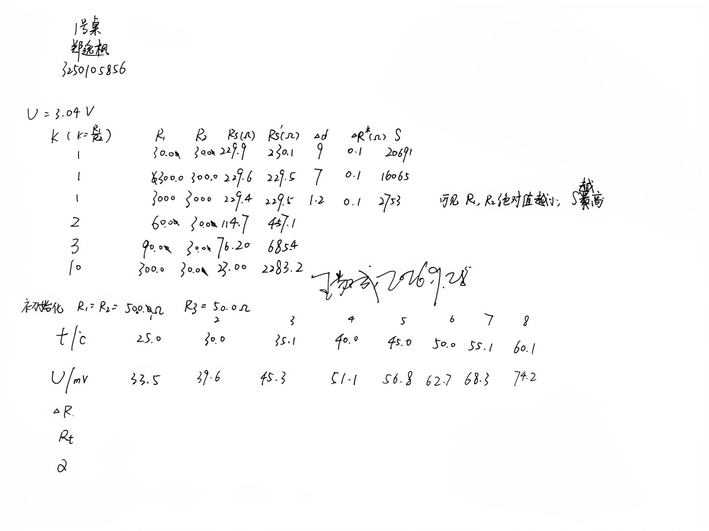
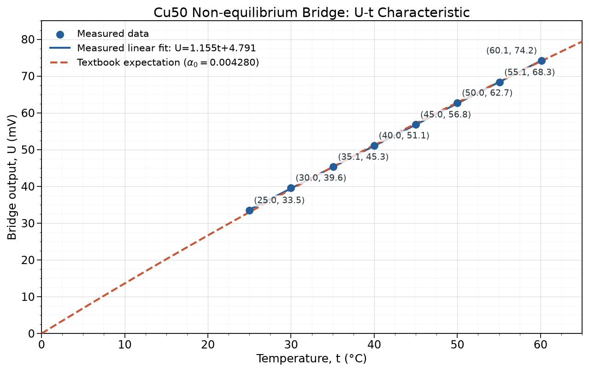

# 浙江大学物理实验报告：直流电桥的应用

## 基本信息

| 项目 | 内容 |
|---|---|
| 课程 | 物理学实验 I |
| 实验名称 | 直流电桥的应用 |
| 实验桌号 | 1 号桌 |
| 指导教师 | 王敬成 |
| 班级 | 软件工程 2502 班 |
| 姓名 | 郑逸枫 |
| 学号 | 3250105856 |
| 实验日期 | 2026 年 9 月 28 日（星期一上午） |

# 一、预习报告

## 1. 实验综述

直流电桥将待测电阻与标准电阻组成四臂网络。本实验包括自组惠斯登电桥测量未知电阻，以及用非平衡直流电桥测量 Cu50 铜电阻温度系数两部分。

惠斯登电桥平衡时检流计中无电流，桥路两中点等电位，满足

$$
\frac{R_1}{R_2}=\frac{R_x}{R_s},
\qquad
R_x=\frac{R_1}{R_2}R_s=kR_s.
$$

交换待测电阻 $R_x$ 与标准电阻 $R_s$ 后再次调平，有

$$
R_x=\frac{R_s'}{k}.
$$

两式相乘得到

$$
R_x=\sqrt{R_sR_s'},
$$

可消除比率臂 $R_1、R_2$ 自身误差对测量结果的影响。

电桥灵敏度定义为

$$
S=\frac{\Delta d}{\Delta R_s/R_s},
$$

其中 $\Delta d$ 为检流计偏转格数，$\Delta R_s$ 为使电桥偏离平衡时标准电阻的改变量。灵敏度越高，电桥对微小电阻变化越敏感。

在非平衡直流电桥中，Cu50 电阻满足近似关系

$$
R_t=R_0(1+\alpha t),
$$

其中 $R_0=50\ \Omega$。在教材的理想模型中，$0\,{}^\circ\mathrm C$ 时有 $R_t=R_0$，且取 $R_1=R_2=R_3=R_0$，因而电桥平衡、$U=0$；如果实验条件允许，可在冰水混合物中进行实际预调平衡。温度升至 $t$ 时，教材给出

$$
U=\frac{\alpha t}{4+2\alpha t}\mathcal E,
\qquad
\alpha=\frac{4U}{t(\mathcal E-2U)},
$$

本实验装置的工作电源取 $\mathcal E=1.3\ \mathrm V$。

## 2. 实验目的

1. 掌握自组惠斯登电桥的接线、调平和交换测量方法。
2. 研究比率臂绝对值及桥臂比率对电桥灵敏度和测量结果的影响。
3. 掌握非平衡电桥把电阻变化转换为输出电压的方法。
4. 测量 Cu50 铜电阻的温度系数，并与教材理论值比较。

## 3. 实验重点与难点

1. 接通电桥时先接电源，再瞬时接通检流计，避免指针冲出量程。
2. 测灵敏度时只微调标准电阻，准确记录电阻改变量和检流计偏转格数。
3. 测量 Cu50 时控制升温速度，待温度及电压稳定后同步读数，减小热滞后和初始零点偏移。

# 二、实验操作与原始数据

## 1. 实验操作

### 1.1 自组惠斯登电桥

1. 按惠斯登电桥原理连接检流计、电阻箱、待测电阻、比率臂和直流电源，电源电压为 $3.04\ \mathrm V$。
2. 先选择 $k=R_1/R_2=1$，调节六旋钮电阻箱 $R_s$ 使检流计指零，记录 $R_s$。
3. 在 $k=1$ 条件下分别取 $R_1=R_2=30.0\ \Omega$、$300.0\ \Omega$ 和 $3000\ \Omega$，改变 $R_s$ 为 $\Delta R_s=0.1\ \Omega$，记录检流计偏转格数，比较比率臂绝对值对灵敏度的影响，并选出灵敏度最高的桥臂设置。
4. 采用选定的桥臂设置，交换 $R_x$ 与 $R_s$ 的位置，再次调平并记录 $R_s'$，按 $R_x=\sqrt{R_sR_s'}$ 计算待测电阻。
5. 另取 $k=2、3、10$，重复交换法测量，以观察桥臂比率选择对结果的影响。

### 1.2 Cu50 非平衡电桥

1. 按教材要求连接 FQJ 型非平衡直流电桥、Cu50 传感器和温控加热装置，将三个初始桥臂设置为 $R_1=R_2=R_3=50.0\ \Omega$。
2. 实验现场室温约为 $24\,{}^\circ\mathrm C$，且不具备冰水混合物条件，因此未进行 $0\,{}^\circ\mathrm C$ 实际预调平衡；将功能开关置于“非平衡--电压”挡，按三桥臂均为 $50.0\ \Omega$ 的教材理想模型进行数据处理。
3. 待室温示数稳定后按下 B、G 按钮，记录首组温度 $t$ 与非平衡电压 $U$。
4. 从约 $25\,{}^\circ\mathrm C$ 开始加热，约每升高 $5\,{}^\circ\mathrm C$，待温度稳定后按下 B、G 按钮，记录非平衡电压 $U$ 及对应温度 $t$。

## 2. 实验原始数据

## 3. 自组电桥原始数据

### 3.1 比率臂绝对值与灵敏度

以下三组均满足 $k=1$，其目的不是进行三次重复测量，而是在其他条件相同的情况下比较 $R_1、R_2$ 的绝对值对电桥灵敏度的影响。

| $R_1=R_2/\Omega$ | $R_s/\Omega$ | $R_s'/\Omega$ | $\Delta R_s/\Omega$ | $\Delta d$/格 |
|---:|---:|---:|---:|---:|
| 30.0 | 229.9 | 230.1 | 0.1 | 9.0 |
| 300.0 | 229.6 | 229.5 | 0.1 | 7.0 |
| 3000 | 229.4 | 229.5 | 0.1 | 1.2 |

### 3.2 交换法与桥臂比率

由上一节可知，$R_1=R_2=30.0\ \Omega$ 时电桥灵敏度最高，因此交换法结果中只保留该 $k=1$ 代表组，其余两组 $k=1$ 数据只用于灵敏度比较。

| $k=R_1/R_2$ | $R_1/\Omega$ | $R_2/\Omega$ | $R_s/\Omega$ | $R_s'/\Omega$ |
|---:|---:|---:|---:|---:|
| 1 | 30.0 | 30.0 | 229.9 | 230.1 |
| 2 | 60.0 | 30.0 | 114.7 | 457.1 |
| 3 | 90.0 | 30.0 | 76.20 | 685.4 |
| 10 | 300.0 | 30.0 | 23.00 | 2283.2 |

## 4. Cu50 原始数据

| 次数 | 1 | 2 | 3 | 4 | 5 | 6 | 7 | 8 |
|---:|---:|---:|---:|---:|---:|---:|---:|---:|
| $t/{}^\circ\mathrm C$ | 25.0 | 30.0 | 35.1 | 40.0 | 45.0 | 50.0 | 55.1 | 60.1 |
| $U/\mathrm{mV}$ | 33.5 | 39.6 | 45.3 | 51.1 | 56.8 | 62.7 | 68.3 | 74.2 |

# 三、结果与分析

## 1. 自组电桥测量结果

### 1.1 比率臂绝对值对灵敏度的影响

按教材定义

$$
S=\frac{\Delta d}{\Delta R_s/R_s}
=\frac{\Delta dR_s}{\Delta R_s}.
$$

计算得到：

| $R_1=R_2/\Omega$ | $\Delta d$/格 | $\Delta R_s/\Omega$ | $S$ |
|---:|---:|---:|---:|
| 30.0 | 9.0 | 0.1 | 20691 |
| 300.0 | 7.0 | 0.1 | 16072 |
| 3000 | 1.2 | 0.1 | 2753 |

第二组手写值有误。按 $R_s=229.6\ \Omega$、$\Delta d=7.0$ 格和 $\Delta R_s=0.1\ \Omega$ 重新计算，得到 $S=16072$，报告采用该重算值。

三组数据的桥臂比率均为 1，只有比率臂绝对值不同。随着 $R_1=R_2$ 从 $30.0\ \Omega$ 增大到 $3000\ \Omega$，灵敏度由 20691 降至 2753。因此，在本实验电源、检流计及待测电阻条件下，较小的比率臂绝对值可获得更高的电桥灵敏度。这三组数据用于说明灵敏度变化，不应取平均作为 $R_x$ 的重复测量结果。

因此，后续交换法测量选用灵敏度最高的 $R_1=R_2=30.0\ \Omega$ 组。

### 1.2 交换法测量待测电阻

对各组数据按

$$
R_x=\sqrt{R_sR_s'}
$$

重新计算。第 1 组例如

$$
R_x=\sqrt{229.9\times230.1}\ \Omega
=230.0\ \Omega.
$$

不同桥臂比率下的结果如下。$k=1$ 仅列上一节选定的高灵敏度代表组。

| $k$ | $R_s/\Omega$ | $R_s'/\Omega$ | $R_x/\Omega$ | 相对第 1 组偏差 |
|---:|---:|---:|---:|---:|
| 1 | 229.9 | 230.1 | 230.0 | 0 |
| 2 | 114.7 | 457.1 | 229.0 | $-0.4458\%$ |
| 3 | 76.20 | 685.4 | 228.5 | $-0.6377\%$ |
| 10 | 23.00 | 2283.2 | 229.2 | $-0.3659\%$ |

四组结果均在约 $228.5\text{--}230.0\ \Omega$ 范围内。$k=1$ 时标准电阻与待测电阻同数量级，电阻箱有效数字利用较充分，因此选取该组作为最终结果。

### 1.3 待测电阻的不确定度

教材实验 4.2 对自组电桥给出的相对不确定度为

$$
E=\frac{\Delta R_x}{R_x}
=\sqrt{\left(0.001+\frac{0.002m}{R_s}\right)^2
+\left(\frac{0.2}{S}\right)^2}.
$$

六旋钮电阻箱取 $m=6$。对灵敏度最高的 $R_1=R_2=30.0\ \Omega$ 组，有

$$
\begin{aligned}
E
&=\sqrt{\left(0.001+\frac{0.002\times6}{229.9}\right)^2
+\left(\frac{0.2}{20691}\right)^2}\\
&=1.052\times10^{-3}=0.1052\%,\\
\Delta R_x&=ER_x=0.2420\ \Omega.
\end{aligned}
$$

不确定度首位为 2，保留两位有效数字，并使测量值末位与不确定度末位对齐，结果为：

$$
\boxed{R_x=(230.00\pm0.24)\ \Omega},
\qquad
\boxed{E=0.11\%}.
$$

## 2. Cu50 温度系数

### 2.1 各温度点计算

教材给出

$$
\alpha_i=\frac{4U_i}{t_i(\mathcal E-2U_i)},
\qquad \mathcal E=1.3\ \mathrm V.
$$

同时可计算

$$
\Delta R_i=50\alpha_it_i,
\qquad
R_{t,i}=50+\Delta R_i.
$$

例如第 1 组

$$
\alpha_1
=\frac{4\times0.0335}{25.0(1.3-2\times0.0335)}
=0.004347\ {}^\circ\mathrm C^{-1}.
$$

各组结果为：

| $t/{}^\circ\mathrm C$ | $U/\mathrm{mV}$ | $\Delta R/\Omega$ | $R_t/\Omega$ | $\alpha/({}^\circ\mathrm C^{-1})$ |
|---:|---:|---:|---:|---:|
| 25.0 | 33.5 | 5.434 | 55.43 | 0.004347 |
| 30.0 | 39.6 | 6.488 | 56.49 | 0.004325 |
| 35.1 | 45.3 | 7.491 | 57.49 | 0.004269 |
| 40.0 | 51.1 | 8.532 | 58.53 | 0.004266 |
| 45.0 | 56.8 | 9.575 | 59.58 | 0.004256 |
| 50.0 | 62.7 | 10.68 | 60.68 | 0.004270 |
| 55.1 | 68.3 | 11.74 | 61.74 | 0.004262 |
| 60.1 | 74.2 | 12.89 | 62.89 | 0.004288 |

平均温度系数为

$$
\bar\alpha=\frac{1}{8}\sum_{i=1}^{8}\alpha_i
=0.004285\ {}^\circ\mathrm C^{-1}.
$$

教材附录给出 Cu50 的理论值

$$
\alpha_0=0.004280\ {}^\circ\mathrm C^{-1},
$$

因此相对误差为

$$
\delta_\alpha
=\frac{|\bar\alpha-\alpha_0|}{\alpha_0}\times100\%
=0.1258\%\approx0.13\%.
$$

### 2.2 $U-t$ 特性曲线

实测数据的线性拟合为

$$
U/\mathrm{mV}=1.155\,t/{}^\circ\mathrm C+4.791,
\qquad R^2=0.9999.
$$

实验点具有很好的线性趋势，并与教材理论曲线基本重合。

### 2.3 A 类标准不确定度

对 8 个温度点的 $\alpha_i$ 进行统计，得

$$
s(\alpha)=3.318\times10^{-5}\ {}^\circ\mathrm C^{-1},
$$

$$
u_A(\bar\alpha)=\frac{s(\alpha)}{\sqrt8}
=1.173\times10^{-5}\ {}^\circ\mathrm C^{-1}.
$$

按课程规则修约后

$$
\boxed{\bar\alpha=(4.285\pm0.012)\times10^{-3}\ {}^\circ\mathrm C^{-1}}
\qquad (u_A,\ k=1).
$$

相对 A 类标准不确定度为 $0.274\%$。由于电压表、温度传感器和工作电源的允许误差限未知，无法评定 B 类标准不确定度，故本报告仅给出 A 类标准不确定度。

## 3. 误差分析

1. 从不同比率臂下的 $R_x$ 可以看出，测量结果在 $228.5\text{--}230.0\ \Omega$ 之间，最大值与最小值相差约 $1.5\ \Omega$。待测电阻的标称值为 $220\ \Omega$，而交换法测得 $R_x=230.0\ \Omega$，相对标称值的偏差为

   $$
   \frac{|230.0-220|}{220}\times100\%=4.545\%\approx4.5\%.
   $$

   标称值不一定等于电阻的实际真值，而且本次实验没有记录该电阻的允许误差等级，因此不能把这 $4.5\%$ 全部看成测量误差。可能原因如下：

   - **偶然误差：** 调节电阻箱时，检流计指针会有轻微摆动，对“指零”位置的判断也会有少量差异；接线柱的轻微松动也可能使平衡点在重新接线后发生小幅变化。
   - **系统误差：** 比率臂和电阻箱的实际阻值与标称值可能存在偏差，导线电阻和接触电阻也会加入桥臂。交换法能减小比率臂误差的影响，但不能完全消除电阻箱示值偏差和接触电阻。

2. Cu50 的各组 $\alpha_i$ 在 $4.256\times10^{-3}\text{--}4.347\times10^{-3}\ {}^\circ\mathrm C^{-1}$ 之间波动，平均值为 $4.285\times10^{-3}\ {}^\circ\mathrm C^{-1}$，与教材理论值的相对误差仅为 $0.13\%$。八个实测电压与理论值的差值最小为 $-0.297\ \mathrm{mV}$，最大为 $+0.491\ \mathrm{mV}$，平均差仅为 $+0.007\ \mathrm{mV}$，未见明显的整体零点偏移。剩余偏差可能来自：

   - **偶然误差：** 温控仪和电压表的示数会有小幅波动；若每次读数时等待时间不完全一致，温度和电压也可能没有同时稳定，使各点计算得到的 $\alpha_i$ 产生波动。
   - **系统误差：** 计算时将电桥工作电压按标称值 $1.3\ \mathrm V$ 处理，并假定初始桥臂电阻均为 $50.0\ \Omega$。实际工作电压、桥臂电阻和 Cu50 的零度电阻若与标称值存在偏差，会使所有 $\alpha_i$ 同向变化。

3. 加热过程中，Cu50 传感器本身、水体和温控仪探头之间需要一定时间才能达到热平衡。若升温过快或示数刚变化就立即读数，Cu50 的实际温度会滞后于温控仪示数，从而使温度系数产生同一方向的系统偏差。所以在测量时应等待温度和电压都稳定后再同时读数。

# 四、实验探讨与思考题

## 1. 实验心得

通过本次实验，我学会了利用自组惠斯登电桥测量未知电阻，也了解了非平衡电桥将电阻变化转换为电压信号的原理。在实验过程中，应根据待测电阻的大致范围选择合适的比率臂，并尽量调大电桥灵敏度；调平时观察检流计的偏转方向，再逐步逼近平衡点，计算 $R_x$ 时保留4位有效数字；测量 Cu50 时，应等待温度和电压示数都稳定后再同时读数，以减小热滞后的影响。此外，实验记录不能只保留测量数值，还要记下仪器的误差限、实际工作以及初始化条件，便于后续的不确定度和误差分析。

## 2. 思考题

1. **为了提高电桥测量灵敏度，应采取哪些措施？为什么？** 在不过载的前提下，可以适当提高电源电压，选用更灵敏的检流计，并使各桥臂阻值尽量接近。本实验中，减小比率臂的绝对值也能提高灵敏度，使微小电阻变化引起更明显的指针偏转。

2. **用电桥测电阻时，若线路接通后检流计指针总是往一个方向偏转或总不偏转，试分析是什么原因？** 指针总向一侧偏转，说明调节过程中没有越过平衡点，可能是比率臂不合适、电阻箱量程不够或接线有误。指针始终不动，则应检查电源、检流计回路和各接线点是否正常。

3. **惠斯登电桥比率臂选取的原则是什么？为什么要这样选取？** 应先估计待测电阻，再选择比率臂，使平衡时的标准电阻落在电阻箱的有效量程内。条件允许时尽量取 $k\approx1$，这样既能充分利用有效数字，也有利于提高灵敏度。

4. **简述非平衡电桥与平衡电桥之间的区别。** 平衡电桥通过调节桥臂使输出为零，再由平衡条件求未知电阻；非平衡电桥则根据输出电压的大小求电阻变化，更适合连续测量。

5. **非平衡电桥在工程中有哪些应用？举例说明。** 它能把微小的电阻变化转换为电压信号，因此常与电阻式传感器配合使用。例如，铜电阻电桥可用于测温，应变片电桥可用于电子秤、压力测量和结构应变监测。
